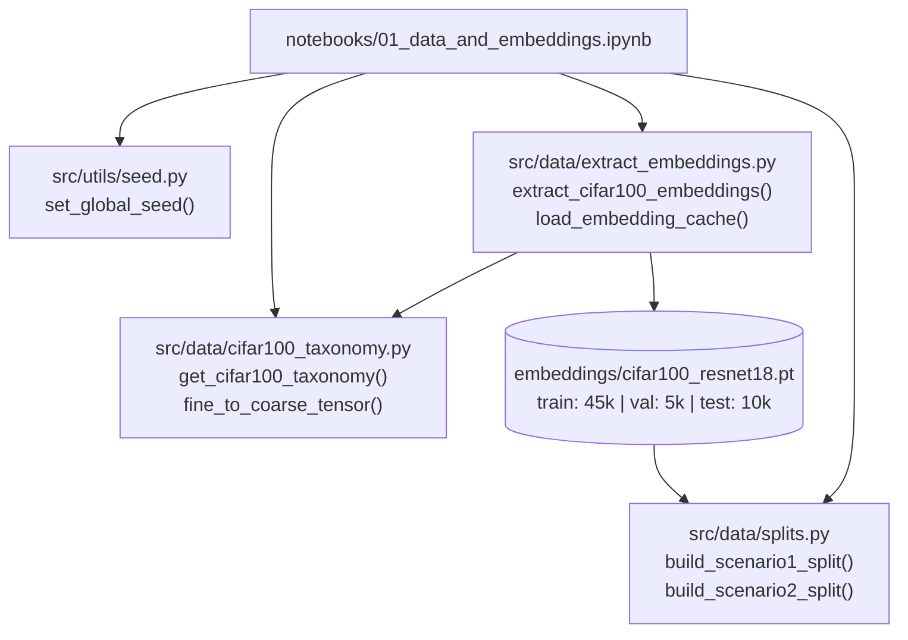

# F1: Project Scaffold, CIFAR-100 Loader & Embedding Cache Design

**Spec**: `.specs/features/01-data-and-embeddings/spec.md`
**Status**: Approved

---

## Architecture Overview

Feature `F1` builds the foundational data and environment layer of `mcts-hnm` in accordance with `AD-001` (Two-Tier Execution), `AD-003` (Standardized `uv` + English codebase), `AD-004` (Scenario 1 & Scenario 2 classification regimes), and `AD-008` (Modular `src/` library orchestrated by versioned Jupyter notebooks in `notebooks/`).

All computational and data-manipulation rules execute inside importable, unit-tested Python modules under `src/utils/` and `src/data/`, while `notebooks/01_data_and_embeddings.ipynb` acts as a thin interactive orchestrator for remote JupyterHub execution.



---

## Code Reuse Analysis

### Existing Components to Leverage

| Component | Location | How to Use |
| --------- | -------- | ---------- |
| Repository Architectural Specifications | `ARCHITECTURE.md`, `ROADMAP.md` | Follow module layout (`src/utils/`, `src/data/`, `notebooks/`, `tests/`) and hyperparameter conventions |
| Active Architectural Decisions | `.specs/STATE.md` (`AD-001`–`AD-008`) | Enforce Tier-1 `[N, 512]` feature cache format, Scenario 1/2 split contracts, and thin notebook orchestration |

### Integration Points

| System | Integration Method |
| ------ | ------------------ |
| `torchvision.datasets.CIFAR100` | Wrapped by `src/data/extract_embeddings.py` with automatic download and custom callable injection for offline unit tests |
| `torchvision.models.resnet18` | Loaded with `ResNet18_Weights.IMAGENET1K_V1`, `fc = nn.Identity()`, `eval()` mode, and `torch.no_grad()` |
| Downstream Features (`F2`, `F3`, `F4`) | Consume `EmbeddingCacheBundle`, `Scenario1Split`, `Scenario2Split`, and `CIFAR100Taxonomy` directly |

---

## Components

### 1. Package & Test Configuration (`pyproject.toml` & `src/__init__.py`)

- **Purpose**: Declare project metadata, dependencies, `pytest` configuration, and `setuptools`/`hatchling` package discovery for `src/`.
- **Location**: `pyproject.toml`, `src/__init__.py`, `src/utils/__init__.py`, `src/data/__init__.py`
- **Interfaces**:
  - Standard PEP 621 `pyproject.toml` installable via `uv sync` or `uv pip install -e .`
- **Dependencies**: `torch`, `torchvision`, `numpy`, `scipy`, `scikit-learn`, `matplotlib`, `seaborn`, `ipykernel`, `nbformat`, `pytest`
- **Reuses**: `AD-003`, `AD-008`

### 2. Deterministic Seed Manager (`src/utils/seed.py`)

- **Purpose**: Enforce bit-for-bit reproducibility across Python, NumPy, and PyTorch random number generators.
- **Location**: `src/utils/seed.py`
- **Interfaces**:
  - `set_global_seed(seed: int, deterministic_cudnn: bool = True) -> int` — Validates `isinstance(seed, int)` (excluding `bool`) and `seed >= 0`, sets `PYTHONHASHSEED`, seeds `random`, `np.random`, `torch.manual_seed`, `torch.cuda.manual_seed_all`, configures cuDNN determinism, and returns `seed`.
  - `get_torch_generator(seed: int, device: str = "cpu") -> torch.Generator` — Returns a seeded `torch.Generator` instance for DataLoader reproducibility.
- **Dependencies**: `os`, `random`, `numpy`, `torch`
- **Reuses**: None (foundational utility)

### 3. CIFAR-100 Coarse-to-Fine Taxonomy (`src/data/cifar100_taxonomy.py`)

- **Purpose**: Provide static, verified bijective mappings between CIFAR-100's 100 fine classes (`0..99`, alphabetically sorted as in `torchvision`) and 20 coarse superclasses (`0..19`).
- **Location**: `src/data/cifar100_taxonomy.py`
- **Interfaces**:
  - `CIFAR100_FINE_CLASSES: tuple[str, ...]` — Length-100 tuple of official CIFAR-100 fine class names in canonical index order `0..99`.
  - `CIFAR100_COARSE_CLASSES: tuple[str, ...]` — Length-20 tuple of official CIFAR-100 coarse superclass names in canonical index order `0..19`.
  - `SUPERCLASS_TO_FINE_NAMES: dict[str, tuple[str, ...]]` — Mapping from each coarse superclass name to its 5 constituent fine class names.
  - `get_cifar100_taxonomy() -> CIFAR100Taxonomy` — Returns a frozen dataclass containing `fine_names`, `coarse_names`, `fine_to_coarse_idx: np.ndarray` (`shape: (100,)`, `int64`), and `coarse_to_fine_ids: dict[int, tuple[int, ...]]`.
  - `fine_to_coarse_tensor(fine_labels: torch.Tensor | np.ndarray) -> torch.Tensor | np.ndarray` — Validates that all entries are integers in `[0, 99]` and maps them to coarse indices in `[0, 19]`, preserving input container type (`torch.Tensor` device/shape or `np.ndarray`).
- **Dependencies**: `dataclasses`, `numpy`, `torch`
- **Reuses**: Standard CIFAR-100 Krizhevsky (2009) taxonomy specification

### 4. Stratified Split & Frozen ResNet-18 Embedding Extractor (`src/data/extract_embeddings.py`)

- **Purpose**: Partition CIFAR-100 training data into stratified train/val splits, extract 512-d embeddings using a frozen ResNet-18 trunk, and persist/validate the disk cache atomically.
- **Location**: `src/data/extract_embeddings.py`
- **Interfaces**:
  - `create_stratified_train_val_indices(labels: np.ndarray | Sequence[int], val_fraction: float = 0.1, seed: int = 42) -> tuple[np.ndarray, np.ndarray]` — Validates `0.0 < val_fraction < 1.0`, partitions indices per class deterministically using `np.random.default_rng(seed)`, and returns sorted disjoint `(train_indices, val_indices)`.
  - `build_frozen_resnet18_extractor(device: str | torch.device = "cpu", pretrained: bool = True) -> nn.Module` — Builds `resnet18` with `fc = nn.Identity()` in `eval()` mode with frozen parameters (`requires_grad = False`).
  - `extract_cifar100_embeddings(data_dir: str | Path = "data", cache_path: str | Path = "embeddings/cifar100_resnet18.pt", batch_size: int = 256, val_fraction: float = 0.1, seed: int = 42, device: str | None = None, overwrite: bool = False, dataset_factory: Callable | None = None, backbone: nn.Module | None = None) -> dict[str, Any]` — Orchestrates cache lookup, dataset loading, stratified splitting, batched feature extraction, atomic file save (`.tmp` $\rightarrow$ rename), and integrity validation.
  - `load_embedding_cache(cache_path: str | Path) -> dict[str, Any]` — Loads and validates an existing embedding bundle from `cache_path`, raising `ValueError` on missing keys, dimension mismatch (`shape[1] != 512`), length mismatch, or `NaN`/`Inf` values.
- **Dependencies**: `pathlib`, `torch`, `torchvision`, `numpy`, `src.utils.seed`, `src.data.cifar100_taxonomy`
- **Reuses**: `set_global_seed()`, `fine_to_coarse_tensor()`

### 5. Scenario 1 & Scenario 2 Dataset Splitters (`src/data/splits.py`)

- **Purpose**: Construct deterministic index pools for Imbalanced Binary One-vs-Rest (Scenario 1) and 100-way Multi-class Curriculum (Scenario 2).
- **Location**: `src/data/splits.py`
- **Interfaces**:
  - `DEFAULT_SCENARIO1_TARGETS: tuple[str, ...] = ("beaver", "oak_tree", "pickup_truck", "rocket", "shark")`
  - `IMBALANCE_RATIOS: dict[str, float] = {"1:10": 0.10, "1:50": 0.02, "1:100": 0.01}`
  - `build_scenario1_split(fine_labels: torch.Tensor | np.ndarray, target_class: int | str, pos_fraction: float = 0.10, seed: int = 42) -> Scenario1Split` — Resolves `target_class` (by int `0..99` or fine class name), validates `0.0 < pos_fraction <= 1.0`, subsamples $\max(1, \lfloor \text{pos\_fraction} \times N_{\text{target}} \rfloor)$ positive indices using `np.random.default_rng(seed)`, collects all sample indices for the 99 negative classes, and returns a `Scenario1Split` dataclass.
  - `build_scenario2_split(fine_labels: torch.Tensor | np.ndarray) -> Scenario2Split` — Validates all 100 classes `0..99` are present and maps each fine class ID to its `np.ndarray` of sample indices.
- **Dependencies**: `dataclasses`, `numpy`, `torch`, `src.data.cifar100_taxonomy`
- **Reuses**: `CIFAR100_FINE_CLASSES`, `get_cifar100_taxonomy()`

### 6. Notebook 01: Data & Embeddings Orchestrator (`notebooks/01_data_and_embeddings.ipynb`)

- **Purpose**: Versioned end-to-end Jupyter notebook for remote JupyterHub that runs CIFAR-100 download, ResNet-18 embedding extraction, cache verification, and Scenario 1/2 split visualizations (`AD-008`).
- **Location**: `notebooks/01_data_and_embeddings.ipynb`
- **Interfaces**:
  - Valid `nbformat` v4 `.ipynb` notebook with structured Markdown narratives and thin code cells calling `src.utils.seed`, `src.data.cifar100_taxonomy`, `src.data.extract_embeddings`, and `src.data.splits`.
- **Dependencies**: `nbformat`, `matplotlib`, `seaborn`, `src.utils.seed`, `src.data.*`
- **Reuses**: All `F1` library components

---

## Data Models

### `CIFAR100Taxonomy` (`src/data/cifar100_taxonomy.py`)

```python
@dataclass(frozen=True)
class CIFAR100Taxonomy:
    fine_names: tuple[str, ...]                    # len == 100
    coarse_names: tuple[str, ...]                  # len == 20
    fine_to_coarse_idx: np.ndarray                 # shape: (100,), dtype: int64
    coarse_to_fine_ids: dict[int, tuple[int, ...]] # 20 keys -> 5 fine IDs each
```

### `EmbeddingSplitData` & Cache Bundle (`src/data/extract_embeddings.py`)

```python
# Saved via torch.save() at embeddings/cifar100_resnet18.pt
{
    "train": {
        "embeddings": torch.Tensor,    # float32, shape [45000, 512]
        "fine_labels": torch.Tensor,   # int64, shape [45000]
        "coarse_labels": torch.Tensor, # int64, shape [45000]
        "indices": torch.Tensor,       # int64, shape [45000]
    },
    "val": {
        "embeddings": torch.Tensor,    # float32, shape [5000, 512]
        "fine_labels": torch.Tensor,   # int64, shape [5000]
        "coarse_labels": torch.Tensor, # int64, shape [5000]
        "indices": torch.Tensor,       # int64, shape [5000]
    },
    "test": {
        "embeddings": torch.Tensor,    # float32, shape [10000, 512]
        "fine_labels": torch.Tensor,   # int64, shape [10000]
        "coarse_labels": torch.Tensor, # int64, shape [10000]
        "indices": torch.Tensor,       # int64, shape [10000]
    },
    "metadata": {
        "backbone": "resnet18_imagenet1k_v1",
        "embedding_dim": 512,
        "seed": 42,
        "val_fraction": 0.1,
    },
}
```

### `Scenario1Split` & `Scenario2Split` (`src/data/splits.py`)

```python
@dataclass(frozen=True)
class Scenario1Split:
    target_class_id: int
    target_class_name: str
    pos_fraction: float
    positive_indices: np.ndarray                 # 1D int64 array of subsampled target indices
    negative_indices: np.ndarray                 # 1D int64 array of all negative indices
    negative_class_to_indices: dict[int, np.ndarray] # 99 keys -> sample indices per negative class
    binary_labels: np.ndarray                    # 1D int64 array (1 for target_class, 0 otherwise)

@dataclass(frozen=True)
class Scenario2Split:
    class_to_indices: dict[int, np.ndarray]      # 100 keys (0..99) -> sample indices per fine class
    active_ indices: np.ndarray                   # 1D int64 array of all active sample indices
```

---

## Error Handling Strategy

| Error Scenario | Handling | User Impact |
| -------------- | -------- | ----------- |
| Negative or non-integer seed passed to `set_global_seed()` | Raise `ValueError("Seed must be a non-negative integer...")` | Immediate fail-fast before non-deterministic execution |
| Out-of-range fine label (`< 0` or `> 99`) in `fine_to_coarse_tensor()` or `build_scenario1_split()` | Raise `ValueError` with offending label value | Prevents silent corruption of coarse superclass mappings |
| Invalid `val_fraction` (`<= 0` or `>= 1`) or `pos_fraction` (`<= 0` or `> 1`) | Raise `ValueError` | Clear diagnostic message |
| Corrupted, truncated, or `NaN`-containing cache file at `cache_path` | `load_embedding_cache()` raises `ValueError` detailing the failed check; `extract_cifar100_embeddings()` writes via `.tmp` + `os.replace()` | Prevents partial writes and catches corrupt cache files immediately |

---

## Risks & Concerns

| Concern | Location (file:line) | Impact | Mitigation |
| ------- | -------------------- | ------ | ---------- |
| `torchvision.datasets.CIFAR100` only loads fine labels by default (`targets`), omitting coarse labels | `src/data/cifar100_taxonomy.py:1` | Relying on undocumented internal pickle files for coarse labels is brittle across `torchvision` versions | Embed the canonical 20-superclass $\leftrightarrow$ 100-fine-class lookup table directly in `src/data/cifar100_taxonomy.py` and verify bijectivity in unit tests |
| Downloading 170 MB CIFAR-100 + 45 MB ResNet-18 weights inside unit tests would make `pytest` slow and network-dependent | `src/data/extract_embeddings.py:1` | Unit test failures in sandboxed/offline CI environments | Support dependency injection (`dataset_factory` and `backbone` arguments) in `extract_cifar100_embeddings()` so unit tests run offline in $< 2$ seconds while production notebooks use the real dataset/weights |
| Interrupted disk write on remote JupyterHub could leave a half-written `.pt` file | `src/data/extract_embeddings.py:1` | Subsequent notebook runs with `overwrite=False` would crash with EOFError | Write to `<cache_path>.tmp` and use atomic `Path.replace()` upon completion, plus validate dictionary schema in `load_embedding_cache()` |

---

## Tech Decisions

| Decision | Choice | Rationale |
| -------- | ------ | --------- |
| Dependency injection in `extract_cifar100_embeddings()` | Optional `dataset_factory` and `backbone` parameters defaulting to `torchvision.datasets.CIFAR100` and pretrained `resnet18` | Enables fast, deterministic, offline `pytest` verification of the full extraction and caching pipeline |
| Atomic cache persistence | Save via `torch.save(bundle, tmp_path)` followed by `tmp_path.replace(cache_path)` | Guarantees that `cache_path` is either completely valid or absent |
