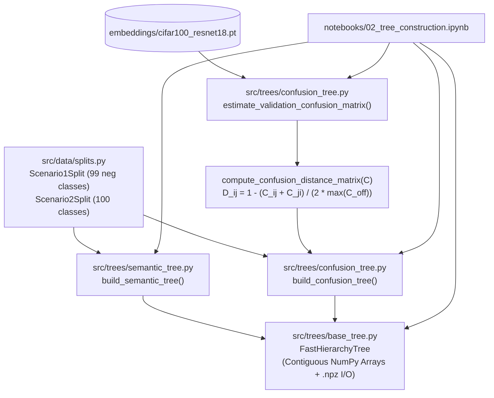

# F2: Dual Hierarchy Construction Engine Design

**Spec**: `.specs/features/02-dual-hierarchy-trees/spec.md`
**Status**: Approved

---

## Architecture Overview

Feature `F2` implements the Dual Hierarchy Construction Engine (`src/trees/`) and its remote JupyterHub orchestration notebook (`notebooks/02_tree_construction.ipynb`) in strict alignment with `AD-001` (Tier-1 cached embeddings), `AD-002` (Semantic vs. Ward Confusion Tree ablation), `AD-004` (Scenario 1 99-leaf One-vs-Rest and Scenario 2 100-leaf Multi-class regimes), and `AD-008` (thin notebook orchestration calling modular `src/` APIs).

Both hierarchy modes compile into an identical `FastHierarchyTree` structure backed by contiguous NumPy arrays, allowing the MCTS agent (`F3`) to traverse either tree without branching on tree construction origin.



---

## Code Reuse Analysis

### Existing Components to Leverage

| Component | Location | How to Use |
| --------- | -------- | ---------- |
| `CIFAR100Taxonomy`, `get_cifar100_taxonomy()` | `src/data/cifar100_taxonomy.py` | Supply the 20 coarse superclasses, 100 fine class names, and `coarse_to_fine_ids` mapping for `build_semantic_tree()` |
| `Scenario1Split`, `Scenario2Split`, `build_scenario1_split()`, `build_scenario2_split()` | `src/data/splits.py` | Provide `negative_class_to_indices` (99 classes) and `class_to_indices` (100 classes) consumed by both tree builders |
| `set_global_seed()` | `src/utils/seed.py` | Ensure deterministic linear probe fitting and synthetic fallback generation for validation confusion matrices |
| `load_embedding_cache()` | `src/data/extract_embeddings.py` | Load cached `[N, 512]` train/val embeddings in `notebooks/02_tree_construction.ipynb` |

### Integration Points

| System | Integration Method |
| ------ | ------------------ |
| `scipy.cluster.hierarchy.linkage` & `scipy.spatial.distance.squareform` | Convert symmetric zero-diagonal confusion distance matrix $D \in \mathbb{R}^{K \times K}$ to condensed form and compute Ward's minimum variance linkage (`method="ward"`) |
| `sklearn.linear_model.LogisticRegression` & `sklearn.metrics.confusion_matrix` | Fit a fast baseline classifier on Tier-1 train embeddings and compute validation confusion matrix $C \in \mathbb{R}^{100 \times 100}$ |
| Feature `F3` (`src/mcts/`) | Consumes `FastHierarchyTree` contiguous arrays (`parents`, `children`, `child_counts`, `is_leaf`, `instance_counts`, `visits`, `q_values`, `class_to_indices`) directly |

---

## Components

### 1. Vectorized Hierarchy Tree Data Structure (`src/trees/base_tree.py`)

- **Purpose**: Provide a contiguous NumPy-backed tree container with O(1) child lookup, structural invariant verification, MCTS state reset, and atomic `.npz` serialization.
- **Location**: `src/trees/base_tree.py`, `src/trees/__init__.py`
- **Interfaces**:
  - `FastHierarchyTree` — Dataclass storing contiguous arrays (`parents`, `children`, `child_counts`, `is_leaf`, `depths`, `leaf_to_class_id`, `instance_counts`, `visits`, `q_values`), `root_id: int`, `tree_type: str`, `node_names: tuple[str, ...]`, and `class_to_indices: dict[int, np.ndarray]`.
  - `FastHierarchyTree.get_children(node_id: int) -> np.ndarray` — Returns 1D `int64` view `self.children[node_id, :self.child_counts[node_id]]`.
  - `FastHierarchyTree.leaf_node_ids() -> np.ndarray` — Returns 1D `int64` array of all leaf node indices.
  - `FastHierarchyTree.class_id_to_leaf_node_id() -> dict[int, int]` — Maps each active CIFAR-100 fine class ID to its leaf node index.
  - `FastHierarchyTree.validate_tree() -> None` — Verifies array shapes/dtypes, single root (`parents[root_id] == -1`), cycle-free reachability of all `V` nodes from `root_id`, internal node child count `>= 1`, leaf node `instance_counts > 0`, and exact parent instance count conservation $M_p = \sum_{c \in \text{Children}(p)} M_c$. Raises `ValueError` on any violation.
  - `FastHierarchyTree.reset_mcts_state() -> None` — Sets `visits[:] = 0` and `q_values[:] = 0.0` in-place.
  - `FastHierarchyTree.save(path: str | Path) -> Path` — Writes all arrays, metadata, and `class_to_indices` to `<path>.tmp.npz` via `np.savez_compressed` and atomically renames to `path`.
  - `FastHierarchyTree.load(path: str | Path) -> FastHierarchyTree` — Loads `.npz` archive, reconstructs `FastHierarchyTree`, and runs `validate_tree()`.
- **Dependencies**: `dataclasses`, `json`, `pathlib`, `numpy`
- **Reuses**: Atomic `.tmp` rename pattern established in `src/data/extract_embeddings.py`

### 2. Mode A — Native Semantic Hierarchy Builder (`src/trees/semantic_tree.py`)

- **Purpose**: Build the 3-level CIFAR-100 Semantic Hierarchy (`Virtual Root -> Superclasses -> Fine Classes`) from `class_to_indices` for Scenario 1 (99 leaves) or Scenario 2 (100 leaves).
- **Location**: `src/trees/semantic_tree.py`
- **Interfaces**:
  - `build_semantic_tree(class_to_indices: dict[int, np.ndarray], taxonomy: CIFAR100Taxonomy | None = None) -> FastHierarchyTree` — Validates `class_to_indices` keys (`0..99`) and non-empty index arrays, creates node `0` as `"root"`, adds active coarse superclass nodes at depth `1`, attaches active fine class leaf nodes at depth `2`, aggregates `instance_counts` bottom-up, validates via `validate_tree()`, and returns the resulting `FastHierarchyTree`.
- **Dependencies**: `numpy`, `src.data.cifar100_taxonomy`, `src.trees.base_tree`
- **Reuses**: `get_cifar100_taxonomy()`, `FastHierarchyTree`

### 3. Mode B — Data-Driven Ward Confusion Tree Builder (`src/trees/confusion_tree.py`)

- **Purpose**: Validate empirical confusion matrices, compute symmetric normalized confusion distances $D_{i,j}$, execute Ward hierarchical clustering, and convert the linkage matrix into a binary `FastHierarchyTree`.
- **Location**: `src/trees/confusion_tree.py`
- **Interfaces**:
  - `validate_confusion_matrix(confusion_matrix: np.ndarray) -> np.ndarray` — Validates that input is a 2D square numeric array with $K \ge 2$, finite entries (no `NaN` or `Inf`), non-negative values ($\ge 0$), and strictly positive row sums ($\sum_j C_{i,j} > 0$ for every row $i$). Raises `ValueError` with diagnostic details on failure.
  - `compute_confusion_distance_matrix(confusion_matrix: np.ndarray) -> np.ndarray` — Calls `validate_confusion_matrix()`, extracts off-diagonal matrix $C^{\text{off}}$ with zeroed diagonal, computes $D_{i,j} = 1.0 - \frac{C^{\text{off}}_{i,j} + C^{\text{off}}_{j,i}}{2.0 \cdot \max(C^{\text{off}})}$ for $i \neq j$ (or $1.0$ if $\max(C^{\text{off}}) == 0$), enforces $D_{i,i} = 0.0$ and symmetry $D = 0.5 (D + D^\top)$ clipped to `[0.0, 1.0]`.
  - `build_confusion_tree(confusion_matrix: np.ndarray, class_to_indices: dict[int, np.ndarray], return_linkage: bool = False) -> FastHierarchyTree | tuple[FastHierarchyTree, np.ndarray, np.ndarray]` — Validates `class_to_indices`, slices `confusion_matrix` to active sorted class IDs if `confusion_matrix.shape == (100, 100)` and `len(class_to_indices) < 100`, computes $D$, converts to condensed distance vector via `scipy.spatial.distance.squareform(D, checks=False)`, computes `linkage_matrix = scipy.cluster.hierarchy.linkage(condensed_D, method="ward")`, and converts the $(K - 1)$ merges into a `FastHierarchyTree` with `2K - 1` nodes (root at index `0`, internal nodes in reverse merge order so root is `0`, and `K` leaves).
  - `estimate_validation_confusion_matrix(train_embeddings: np.ndarray | torch.Tensor, train_labels: np.ndarray | torch.Tensor, val_embeddings: np.ndarray | torch.Tensor, val_labels: np.ndarray | torch.Tensor, num_classes: int = 100, smoothing: float = 1e-3, seed: int = 42) -> np.ndarray` — Fits a deterministic `LogisticRegression(max_iter=200, random_state=seed)` classifier (or prototype nearest-centroid classifier for tiny fixtures) on `train_embeddings`, predicts on `val_embeddings`, and returns the $K \times K$ confusion matrix with additive `smoothing` so zero-row-sum anomalies cannot occur even on small subsets.
- **Dependencies**: `numpy`, `scipy.cluster.hierarchy`, `scipy.spatial.distance`, `sklearn.linear_model`, `sklearn.metrics`, `torch`, `src.data.cifar100_taxonomy`, `src.trees.base_tree`, `src.utils.seed`
- **Reuses**: `FastHierarchyTree`, `get_cifar100_taxonomy()`, `set_global_seed()`

### 4. Notebook 02: Dual Tree Construction Orchestrator (`notebooks/02_tree_construction.ipynb`)

- **Purpose**: Versioned Jupyter notebook for remote JupyterHub that builds Semantic and Ward Confusion trees for Scenario 1 and Scenario 2, plots the confusion distance matrix and Ward dendrogram, verifies invariants, and saves `.npz` tree artifacts (`AD-008`).
- **Location**: `notebooks/02_tree_construction.ipynb`
- **Interfaces**:
  - Valid `nbformat` v4 notebook importing exclusively from `src.utils.seed`, `src.data.*`, and `src.trees.*`.
- **Dependencies**: `nbformat`, `matplotlib`, `seaborn`, `scipy.cluster.hierarchy.dendrogram`, `src.trees.*`
- **Reuses**: All `F1` and `F2` modules

---

## Data Models

### `FastHierarchyTree` (`src/trees/base_tree.py`)

```python
@dataclass
class FastHierarchyTree:
    tree_type: str                           # "semantic" or "confusion_ward"
    root_id: int                             # Always 0
    parents: np.ndarray                      # int64, shape [V], parents[root_id] == -1
    children: np.ndarray                     # int64, shape [V, B_max], padded with -1
    child_counts: np.ndarray                 # int64, shape [V]
    is_leaf: np.ndarray                      # bool, shape [V]
    depths: np.ndarray                       # int64, shape [V]
    leaf_to_class_id: np.ndarray             # int64, shape [V], fine class 0..99 for leaves else -1
    instance_counts: np.ndarray              # int64, shape [V], M_p = sum(M_c)
    visits: np.ndarray                       # int64, shape [V], initialized to 0
    q_values: np.ndarray                     # float64, shape [V], initialized to 0.0
    node_names: tuple[str, ...]              # len == V
    class_to_indices: dict[int, np.ndarray]  # active fine class ID -> 1D int64 sample indices
```

**Relationships**:
- Consumes `class_to_indices` from `Scenario1Split.negative_class_to_indices` (`99` classes) or `Scenario2Split.class_to_indices` (`100` classes).
- Consumed directly by `MCTSHNMAgent` and `DualStreamBatchSampler` in Feature `F3`.

---

## Error Handling Strategy

| Error Scenario | Handling | User Impact |
| -------------- | -------- | ----------- |
| Disconnected node, cycle, invalid `root_id`, or parent/child `instance_counts` mismatch in `FastHierarchyTree` | `validate_tree()` raises `ValueError` detailing the exact node ID and violated invariant | Prevents silent MCTS infinite loops or misweighted $Q_p$ backpropagation |
| Empty `class_to_indices`, out-of-range class ID (`< 0` or `> 99`), or empty index array per class | `build_semantic_tree()` and `build_confusion_tree()` raise `ValueError` | Immediate fail-fast before tree construction |
| Non-square, `< 2x2`, negative, `NaN`/`Inf`, or zero-row-sum confusion matrix passed to `compute_confusion_distance_matrix()` / `build_confusion_tree()` | `validate_confusion_matrix()` raises `ValueError` identifying the offending row or invalid values (`EPIC-02` AC 3) | Clear diagnostic message before calling SciPy linkage |
| Corrupted or missing `.npz` file passed to `FastHierarchyTree.load()` | Raises `ValueError` wrapping missing-key or format errors | Prevents partial tree state loading |

---

## Risks & Concerns

| Concern | Location (file:line) | Impact | Mitigation |
| ------- | -------------------- | ------ | ---------- |
| Diagonal entries $C_{i,i}$ (correct predictions) typically dominate off-diagonal misclassifications ($C_{i,i} \gg C_{i,j}$) | `src/trees/confusion_tree.py:1` | If $\max(C)$ includes the diagonal, off-diagonal similarities $\frac{C_{i,j}+C_{j,i}}{2\max(C)}$ become compressed near $0$ when accuracy improves | Zero out the diagonal ($C^{\text{off}}_{i,i} = 0$) before computing $\max(C^{\text{off}})$ so $D_{i,j}$ spans the full `[0.0, 1.0]` dynamic range across confused class pairs |
| SciPy linkage matrix indexes leaves as `0..K-1` and merged clusters as `K..2K-2` (root at `2K-2`), whereas MCTS expects a consistent `root_id = 0` convention | `src/trees/confusion_tree.py:1` | Inconsistent root indexing between Semantic Tree (`root_id=0`) and Confusion Tree (`root_id=2K-2`) could cause subtle indexing bugs in `F3` | Remap Ward linkage node IDs during tree construction so `root_id == 0` in both Semantic and Confusion trees, verified by `validate_tree()` |
| `np.savez_compressed` appends `.npz` automatically if the filename does not end with `.npz` | `src/trees/base_tree.py:1` | Writing to `path.with_suffix(".tmp")` causes NumPy to create `path.tmp.npz`, breaking `replace()` if the suffix is not `.npz` | Always use a temporary path ending in `.tmp.npz` (e.g., `path.with_name(f"{path.stem}.tmp.npz")`) before `replace(path)` |

---

## Tech Decisions

| Decision | Choice | Rationale |
| -------- | ------ | --------- |
| Canonical `root_id = 0` across all `FastHierarchyTree` builders | Both `build_semantic_tree()` and `build_confusion_tree()` place the virtual root at node index `0` (`parents[0] == -1`, `depths[0] == 0`) | Uniform root convention simplifies MCTS Selection and Backpropagation in `F3` |
| Contiguous `np.ascontiguousarray()` enforcement in `FastHierarchyTree.__post_init__` | Convert all node attribute arrays to C-contiguous arrays of exact target dtype (`int64`, `bool`, `float64`) during initialization | Guarantees cache-friendly memory layout and prevents accidental float/int dtype drift |
