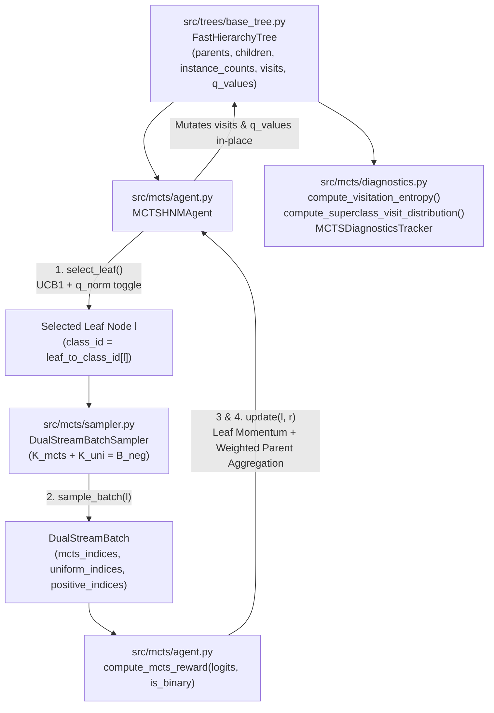

# F3: Core MCTS Hard Negative Mining Agent Design

**Spec**: `.specs/features/03-mcts-hnm-agent/spec.md`
**Status**: Approved

---

## Architecture Overview

Feature `F3` implements the 4-phase Monte Carlo Tree Search Hard Negative Mining engine (`src/mcts/`) on top of the contiguous-array `FastHierarchyTree` from `F2`, adhering to `AD-001` (zero-overhead CPU array operations for >1,000 MCTS steps/sec), `AD-004` (Scenario 1 binary One-vs-Rest and Scenario 2 100-way multi-class support), `AD-005` (controlled ablation between Strict GiantHunter and Enhanced MCTS-HNM), and `AD-008` (clean programmatic Python APIs in `src/mcts/`).



---

## Code Reuse Analysis

### Existing Components to Leverage

| Component | Location | How to Use |
| --------- | -------- | ---------- |
| `FastHierarchyTree` | `src/trees/base_tree.py` | Directly read/mutate contiguous `parents`, `children`, `child_counts`, `is_leaf`, `leaf_to_class_id`, `instance_counts`, `visits`, `q_values`, and `class_to_indices` arrays |
| `CIFAR100Taxonomy`, `get_cifar100_taxonomy()` | `src/data/cifar100_taxonomy.py` | Map leaf fine class IDs (`0..99`) to the 20 CIFAR-100 coarse superclass names in `compute_superclass_visit_distribution()` across both Semantic and Ward Confusion trees |
| `set_global_seed()` | `src/utils/seed.py` | Deterministic seeding for `np.random.Generator` in `DualStreamBatchSampler` |

### Integration Points

| System | Integration Method |
| ------ | ------------------ |
| Feature `F2` (`src/trees/`) | `MCTSHNMAgent` and `DualStreamBatchSampler` accept any `FastHierarchyTree` produced by `build_semantic_tree()` or `build_confusion_tree()` |
| Feature `F4` (`src/training/`) | Training loops call `agent.select_leaf()`, `sampler.sample_batch(leaf_id)`, `compute_mcts_reward()`, `agent.update(leaf_id, reward)`, and `diagnostics_tracker.record_step()` |
| Feature `F5` (`src/mcts/expansion.py`) | Dynamic leaf sub-clustering inspects `tree.visits` and `tree.q_values` maintained by `MCTSHNMAgent` |

---

## Components

### 1. MCTS Selection, Q-Normalization & Backpropagation Engine (`src/mcts/agent.py`)

- **Purpose**: Implement UCB1 tree traversal from root to leaf with configurable sibling Min-Max $Q$-normalization (`q_norm: bool`), reward computation from model logits, leaf momentum updates, and instance-weighted ancestor backpropagation.
- **Location**: `src/mcts/agent.py`, `src/mcts/__init__.py`
- **Interfaces**:
  - `normalize_sibling_q_values(q_values: np.ndarray, eps: float = 1e-5) -> np.ndarray` — Returns 1D `float64` array in `[0.0, 1.0]`. If `max(q_values) == min(q_values)`, returns `np.zeros_like(q_values, dtype=np.float64)`; otherwise computes `(q_values - q_min) / (q_max - q_min + eps)`.
  - `compute_ucb1_scores(q_values: np.ndarray, child_visits: np.ndarray, parent_visits: int, exploration_c: float = 2.0, q_norm: bool = True, eps: float = 1e-5) -> np.ndarray` — Computes $U_i = \tilde{Q}_i + c \sqrt{\frac{\ln \max(N_s, 1)}{n_i + \epsilon}}$ where $\tilde{Q}_i = \bar{Q}_i^{\text{norm}}$ when `q_norm=True` and $\tilde{Q}_i = Q_i$ when `q_norm=False`.
  - `compute_mcts_reward(logits: torch.Tensor | np.ndarray, is_binary: bool = True, target_labels: torch.Tensor | np.ndarray | int | None = None) -> float` — Computes the scalar loss reward $r$ over the MCTS-mined sub-batch: mean `binary_cross_entropy_with_logits` against target `0.0` ($-\frac{1}{K_{\text{mcts}}} \sum \log(1 - \sigma(z_j))$) when `is_binary=True`, or mean multi-class `cross_entropy` against `target_labels` when `is_binary=False`.
  - `MCTSHNMAgent(tree: FastHierarchyTree, exploration_c: float = 2.0, momentum_alpha: float = 0.3, q_norm: bool = True, eps: float = 1e-5)`:
    - `select_child(node_id: int) -> tuple[int, np.ndarray]` — Evaluates children of internal node `node_id`. If any child has `visits == 0`, deterministically selects the first unvisited child; otherwise selects the child maximizing `compute_ucb1_scores()`. Returns `(selected_child_id, ucb_scores)`.
    - `select_leaf() -> tuple[int, list[int]]` — Traverses from `tree.root_id` down to a leaf node $l$, returning `(leaf_node_id, path_node_ids)`.
    - `update(leaf_node_id: int, reward: float) -> float` — Increments `tree.visits[l] += 1`, updates $Q_l^{(t)} = \alpha r + (1 - \alpha) Q_l^{(t-1)}$, and walks upward through `tree.parents` to `root_id`, incrementing `tree.visits[p] += 1` and setting $Q_p = \frac{1}{M_p} \sum_{c \in \text{Children}(p)} M_c Q_c$. Returns updated $Q_l^{(t)}$.
    - `reset() -> None` — Resets `tree.visits` and `tree.q_values` via `tree.reset_mcts_state()`.
- **Dependencies**: `numpy`, `torch`, `torch.nn.functional`, `src.trees.base_tree`
- **Reuses**: `FastHierarchyTree`

### 2. Dual-Stream Hybrid Batch Sampler (`src/mcts/sampler.py`)

- **Purpose**: Assemble mini-batches combining MCTS-mined hard negative instances from the selected leaf with uniformly sampled anchor negatives (and optional positive target instances in Scenario 1).
- **Location**: `src/mcts/sampler.py`
- **Interfaces**:
  - `DualStreamBatch` — Frozen dataclass containing `leaf_node_id: int`, `leaf_class_id: int`, `mcts_indices: np.ndarray`, `uniform_indices: np.ndarray`, `negative_indices: np.ndarray`, `positive_indices: np.ndarray`, `all_indices: np.ndarray`, and `sampled_with_replacement: bool`.
  - `DualStreamBatchSampler(tree: FastHierarchyTree, neg_batch_size: int = 48, dual_stream_ratio: float = 0.5, positive_indices: np.ndarray | None = None, pos_batch_size: int = 0, seed: int = 42)`:
    - `mcts_sub_batch_size: int` — $\lfloor (1 - \beta) B_{\text{neg}} \rfloor$.
    - `uniform_sub_batch_size: int` — $\lceil \beta B_{\text{neg}} \rceil = B_{\text{neg}} - \lfloor (1 - \beta) B_{\text{neg}} \rfloor$.
    - `sample_batch(leaf_node_id: int) -> DualStreamBatch` — Samples `mcts_sub_batch_size` indices from the leaf's class pool (without replacement if pool size $\ge K_{\text{mcts}}$, else with replacement and a single warning per sampler instance), samples `uniform_sub_batch_size` indices uniformly from the global negative pool, optionally samples `pos_batch_size` positive indices, and returns `DualStreamBatch`.
- **Dependencies**: `dataclasses`, `logging`, `math`, `warnings`, `numpy`, `src.trees.base_tree`
- **Reuses**: `FastHierarchyTree`

### 3. Tree Visitation Entropy & RL Diagnostics (`src/mcts/diagnostics.py`)

- **Purpose**: Compute Shannon visitation entropy $H_t$, normalized entropy $H_t / \ln K$, per-leaf visit probabilities, per-superclass visit distributions, and step-by-step RL diagnostic histories.
- **Location**: `src/mcts/diagnostics.py`
- **Interfaces**:
  - `compute_visitation_entropy(tree: FastHierarchyTree) -> tuple[float, float]` — Computes `(entropy_nats, normalized_entropy)` over leaf visit counts $n_1, \dots, n_K$: $H_t = -\sum_{n_i > 0} p_i \ln p_i$ and $H_{\text{norm}} = H_t / \ln K \in [0.0, 1.0]$. Returns `(0.0, 0.0)` when $\sum n_i == 0$.
  - `compute_leaf_visit_distribution(tree: FastHierarchyTree) -> dict[int, float]` — Maps each active fine class ID to its empirical leaf visit probability $p_i \in [0.0, 1.0]$.
  - `compute_superclass_visit_distribution(tree: FastHierarchyTree, taxonomy: CIFAR100Taxonomy | None = None) -> dict[str, float]` — Maps all 20 CIFAR-100 coarse superclass names to their aggregated leaf visit proportions in `[0.0, 1.0]`.
  - `MCTSStepDiagnostic` & `MCTSDiagnosticsTracker` — Records per-step MCTS telemetry (`record_step(step, leaf_node_id, reward)`) and exports summary dictionaries (`summary()`) for downstream logging.
- **Dependencies**: `dataclasses`, `numpy`, `src.data.cifar100_taxonomy`, `src.trees.base_tree`
- **Reuses**: `FastHierarchyTree`, `get_cifar100_taxonomy()`

---

## Data Models

### `DualStreamBatch` (`src/mcts/sampler.py`)

```python
@dataclass(frozen=True)
class DualStreamBatch:
    leaf_node_id: int
    leaf_class_id: int
    mcts_indices: np.ndarray       # int64, shape [K_mcts]
    uniform_indices: np.ndarray    # int64, shape [K_uni]
    negative_indices: np.ndarray   # int64, shape [B_neg] (concat of mcts_indices & uniform_indices)
    positive_indices: np.ndarray   # int64, shape [B_pos] (empty if pos_batch_size == 0)
    all_indices: np.ndarray        # int64, shape [B_pos + B_neg]
    sampled_with_replacement: bool
```

### `MCTSStepDiagnostic` (`src/mcts/diagnostics.py`)

```python
@dataclass(frozen=True)
class MCTSStepDiagnostic:
    step: int
    leaf_node_id: int
    leaf_class_id: int
    reward: float
    leaf_q_value: float
    root_q_value: float
    entropy_nats: float
    normalized_entropy: float
```

---

## Error Handling Strategy

| Error Scenario | Handling | User Impact |
| -------------- | -------- | ----------- |
| Invalid `MCTSHNMAgent` hyperparameters (`exploration_c < 0`, `momentum_alpha <= 0` or `> 1`, `eps <= 0`) | `__init__` raises `ValueError` | Immediate fail-fast on misconfigured experiments |
| `MCTSHNMAgent.update()` called with internal node ID, out-of-range node ID, or `NaN`/`Inf` reward | `update()` raises `ValueError` before mutating `tree.visits` or `tree.q_values` | Prevents corrupting tree state during backpropagation |
| All sibling $Q$-values at an internal node are identical ($Q_{\max} == Q_{\min}$) | `normalize_sibling_q_values()` returns `0.0` for all siblings without dividing by zero | Prevents `NaN` propagation on initial steps or uniform-loss subtrees |
| Selected leaf has fewer instances than $K_{\text{mcts}}$ ($|I_l| < K_{\text{mcts}}$) | `DualStreamBatchSampler.sample_batch()` falls back to `replace=True` and logs/emits a warning once per sampler instance | Preserves constant batch size $B_{\text{neg}}$ without flooding logs |
| `compute_visitation_entropy()` or `compute_superclass_visit_distribution()` called at step 0 ($\sum n_i == 0$) | Returns `(0.0, 0.0)` and `0.0` proportions without division by zero | Safe diagnostic inspection before training starts |

---

## Risks & Concerns

| Concern | Location (file:line) | Impact | Mitigation |
| ------- | -------------------- | ------ | ---------- |
| When parent visit count $N_s = 1$ (after only the first child has been visited once), $\ln(N_s) = \ln(1) = 0.0$, causing the UCB1 exploration bonus $c \sqrt{\ln N_s / (n_i + \epsilon)}$ to evaluate to `0.0` for unvisited siblings | `src/mcts/agent.py:1` | If the first visited child received $Q_0 > 0$, a naive `argmax(U_i)` at $N_s = 1$ would re-select child `0` endlessly and starve all $n_i = 0$ siblings | Explicitly prioritize unvisited children (`n_i == 0`) deterministically in `select_child()` before comparing UCB1 scores across visited children |
| Rounding discrepancy between $\lfloor (1-\beta) B_{\text{neg}} \rfloor$ and $\lceil \beta B_{\text{neg}} \rceil$ under floating-point inaccuracy (e.g., `1.0 - 0.3 = 0.7000000000000001`) | `src/mcts/sampler.py:1` | Could cause $K_{\text{mcts}} + K_{\text{uni}} \neq B_{\text{neg}}$ for certain floats | Compute $K_{\text{mcts}} = \lfloor \text{round}((1.0 - \beta) B_{\text{neg}}, 9) \rfloor$ and set $K_{\text{uni}} = B_{\text{neg}} - K_{\text{mcts}}$ (which equals $\lceil \beta B_{\text{neg}} \rceil$ for exact arithmetic) and assert $K_{\text{mcts}} + K_{\text{uni}} == B_{\text{neg}}$ |

---

## Tech Decisions

| Decision | Choice | Rationale |
| -------- | ------ | --------- |
| In-place mutation of `FastHierarchyTree.visits` and `FastHierarchyTree.q_values` | `MCTSHNMAgent.update()` mutates `tree.visits` and `tree.q_values` in-place rather than copying arrays | Zero memory allocation per MCTS step and automatic persistence when `tree.save()` is called |
| Numerically stable binary MCTS reward computation | Use `torch.nn.functional.binary_cross_entropy_with_logits(logits, zeros)` ($\operatorname{softplus}(z_j)$) instead of $-\log(1 - \sigma(z_j))$ | Avoids $\log(0) = -\infty$ overflow when a hard negative receives a large positive logit $z_j \gg 10$ |
