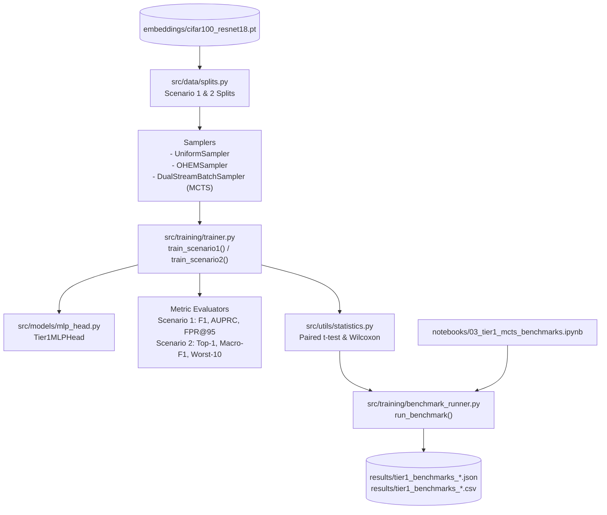

# F4: Downstream Classifiers, Baselines & Tier-1 Benchmark Notebook Design

**Spec**: `.specs/features/04-tier1-benchmark-suite/spec.md`  
**Status**: Approved

---

## Architecture Overview

Feature `F4` implements the downstream classification models, baseline negative samplers, unified training and evaluation loops, and multi-seed statistical benchmark engine in `src/models/`, `src/training/`, and `src/utils/statistics.py`, orchestrated interactively on remote JupyterHub via `notebooks/03_tier1_mcts_benchmarks.ipynb` (`AD-001`, `AD-002`, `AD-004`, `AD-005`, `AD-008`).

---

## Code Reuse Analysis

### Existing Components to Leverage

| Component | Location | How to Use |
| --------- | -------- | ---------- |
| `FastHierarchyTree` | `src/trees/base_tree.py` | Consumed by MCTS strategies in `train_scenario1()` and `train_scenario2()` |
| `build_semantic_tree()`, `build_confusion_tree()` | `src/trees/semantic_tree.py`, `src/trees/confusion_tree.py` | Construct Semantic and Ward Confusion trees across both scenarios |
| `MCTSHNMAgent`, `compute_mcts_reward` | `src/mcts/agent.py` | Provide tree traversal (`select_leaf`), reward calculation, and backpropagation (`update`) |
| `DualStreamBatchSampler` | `src/mcts/sampler.py` | Assemble MCTS batches (`q_norm=False` with $\beta=0.0$ for Strict GiantHunter; `q_norm=True` with $\beta=0.5$ for Enhanced MCTS-HNM) |
| `MCTSDiagnosticsTracker`, `compute_visitation_entropy` | `src/mcts/diagnostics.py` | Record Tree Visitation Entropy and superclass distributions at evaluation steps |
| `Scenario1Split`, `Scenario2Split`, `build_scenario1_split()`, `build_scenario2_split()` | `src/data/splits.py` | Provide deterministic training/test splits and class index mappings |
| `set_global_seed()` | `src/utils/seed.py` | Enforce reproducible multi-seed training across PyTorch, NumPy, and Python |

---

## Components

### 1. Tier-1 MLP Classification Head & Optimizer Factory (`src/models/mlp_head.py`)

- **Purpose**: Implement the 2-layer MLP head matching GiantHunter's supervision architecture (`512 -> 128 -> ReLU -> Dropout(0.1) -> num_outputs`) and provide an optimizer helper.
- **Interfaces**:
  - `Tier1MLPHead(input_dim: int = 512, hidden_dim: int = 128, num_outputs: int = 1, dropout: float = 0.1, squeeze_binary: bool = True)`:
    - Forward pass accepts `x: torch.Tensor` of shape `[B, input_dim]`.
    - If `squeeze_binary=True` and `num_outputs == 1`, output is squeezed to shape `[B]`. Otherwise returns shape `[B, num_outputs]`.
  - `create_mlp_optimizer(model: nn.Module, lr: float = 1e-3, weight_decay: float = 0.0) -> torch.optim.Adam`:
    - Returns `torch.optim.Adam(model.parameters(), lr=lr, weight_decay=weight_decay)`.

### 2. Non-Hierarchical Baseline Samplers (`src/training/baselines.py`)

- **Purpose**: Provide non-tree sampling strategies (`UniformSampler` and `OHEMSampler`) sharing batch sizes and index pool structures with MCTS.
- **Interfaces**:
  - `UniformSampler(negative_indices: np.ndarray, neg_batch_size: int, positive_indices: np.ndarray | None = None, pos_batch_size: int = 0, seed: int = 42)`:
    - `sample_batch() -> tuple[np.ndarray, np.ndarray, np.ndarray]`:
      Returns `(positive_indices, negative_indices, all_indices)`.
  - `OHEMSampler(negative_indices: np.ndarray, neg_batch_size: int, ohem_ratio: int = 4, positive_indices: np.ndarray | None = None, pos_batch_size: int = 0, seed: int = 42)`:
    - `sample_batch(model: nn.Module, features: torch.Tensor, device: torch.device | None = None, is_binary: bool = True, target_labels: torch.Tensor | None = None) -> tuple[np.ndarray, np.ndarray, np.ndarray]`:
      Draws $M_{\text{cand}} = \min(|\text{pool}|, \, r_{\text{ohem}} \cdot B_{\text{neg}})$ candidates, computes per-sample loss in `torch.no_grad()`, picks top-$B_{\text{neg}}$ highest-loss negative samples, and returns `(positive_indices, negative_indices, all_indices)`.

### 3. Unified Scenario 1 & 2 Trainers & Metric Evaluators (`src/training/trainer.py`)

- **Purpose**: Train downstream classifiers under `uniform`, `ohem`, `mcts_strict`, and `mcts_enhanced` strategies, record evaluation curves, and evaluate Scenario 1 & 2 test metrics.
- **Interfaces**:
  - `evaluate_scenario1_metrics(model: nn.Module, features: torch.Tensor, binary_labels: np.ndarray | torch.Tensor, batch_size: int = 256) -> dict[str, float]`:
    Returns `{"loss", "f1", "precision", "recall", "auprc", "fpr_at_95_recall"}`.
  - `evaluate_scenario2_metrics(model: nn.Module, features: torch.Tensor, labels: np.ndarray | torch.Tensor, batch_size: int = 256) -> dict[str, float]`:
    Returns `{"loss", "top1_accuracy", "macro_f1", "worst_10_class_recall"}`.
  - `train_scenario1(...) -> dict[str, object]`:
    Trains with `BCEWithLogitsLoss`, supports all 4 strategies, evaluates every `eval_every` steps, and returns history dictionary with final test metrics.
  - `train_scenario2(...) -> dict[str, object]`:
    Trains with `CrossEntropyLoss(label_smoothing=0.1)`, supports all 4 strategies, evaluates every `eval_every` steps, and returns history dictionary with final test metrics.

### 4. Paired Statistical Test Suite (`src/utils/statistics.py`)

- **Purpose**: Compute paired Student's $t$-test and Wilcoxon signed-rank test statistics across multi-seed runs.
- **Interfaces**:
  - `compute_paired_statistical_tests(scores_a: np.ndarray | list[float], scores_b: np.ndarray | list[float]) -> dict[str, float]`:
    Returns `{"mean_a", "std_a", "mean_b", "std_b", "mean_diff", "t_stat", "t_pvalue", "wilcoxon_stat", "wilcoxon_pvalue"}` with zero-difference safeguards.

### 5. Multi-Seed Benchmark Runner & Persistence (`src/training/benchmark_runner.py`)

- **Purpose**: Execute multi-seed experiment grids across strategies and tree types, aggregate results, compute pairwise statistical comparisons against `mcts_enhanced`, and save atomic JSON/CSV summaries.
- **Interfaces**:
  - `run_benchmark(config: BenchmarkConfig) -> dict[str, object]`:
    Executes all runs deterministically, aggregates `mean ± std`, runs `compute_paired_statistical_tests`, and saves results to `output_dir`.

### 6. Orchestration Notebook (`notebooks/03_tier1_mcts_benchmarks.ipynb`)

- **Purpose**: Interactive JupyterHub entrypoint running:
  1. Experiment Axis 1: Sampler Comparison (`uniform`, `ohem`, `mcts_strict`, `mcts_enhanced`) on Scenario 1.
  2. Experiment Axis 2: Semantic vs. Ward Confusion Tree on Scenario 1.
  3. Experiment Axis 3: Hyperparameter Sensitivity ($c \in \{0.5, 1.0, 2.0, 4.0\}$ and $\alpha \in \{0.1, 0.3, 0.5, 0.7\}$).
  4. Experiment Axis 4: Scenario 2 Multi-Class Curriculum Benchmark.

---

## Error Handling Strategy

| Error Scenario | Handling | User Impact |
| -------------- | -------- | ----------- |
| Invalid hyperparameter values in `Tier1MLPHead`, `UniformSampler`, `OHEMSampler` | Raise `ValueError` | Immediate fail-fast before training starts |
| Non-finite values or length mismatch in `compute_paired_statistical_tests` | Raise `ValueError` | Prevents corrupt metric aggregation |
| Paired difference array is all zeros ($a_i == b_i$) | Return `p_value=1.0` and `stat=0.0` | Prevents crashes on tied baselines |
| OHEM candidate pool smaller than requested candidates | Clamp candidate pool to available pool size | Robust execution on small datasets or test fixtures |
