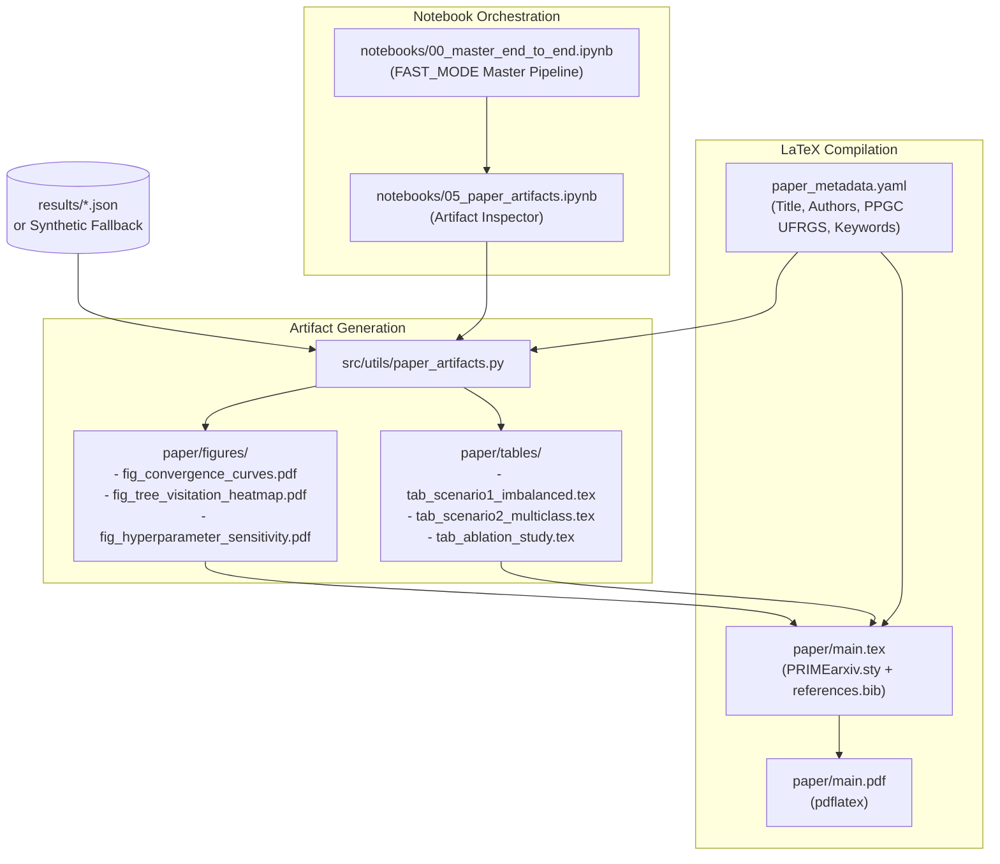

# F6: Automated Paper Artifacts, Master Notebook & LaTeX Manuscript Design

**Spec**: `.specs/features/06-paper-and-artifacts/spec.md`  
**Status**: Approved

---

## Architecture Overview

Feature `F6` delivers the automated academic delivery layer of the MCTS-HNM project (`AD-007`, `AD-008`, `AD-009`):
1. **Paper Metadata (`paper_metadata.yaml`)**: Root configuration holding title, author list, institutional affiliation (PPGC UFRGS), and keywords (`AD-009`).
2. **Automated Figure & Table Generator (`src/utils/paper_artifacts.py`)**: Dual-mode ingestion of multi-seed benchmark metrics (`results/` or synthetic fallback), rendering vector PDF + raster PNG plots in `paper/figures/` and LaTeX `booktabs` tables in `paper/tables/`.
3. **Versioned Notebooks (`notebooks/`)**:
   - `notebooks/05_paper_artifacts.ipynb`: Interactive rendering and disk export of all publication figures and tables.
   - `notebooks/00_master_end_to_end.ipynb`: Single-entry end-to-end pipeline with `FAST_MODE = True` default smoke-test toggle covering the full research lifecycle (`AD-008`).
4. **LaTeX Scientific Manuscript (`paper/`)**: arXiv / Prime AI preprint template (`PRIMEarxiv.sty`, `references.bib`, `main.tex`) compiling cleanly to `paper/main.pdf` via `pdflatex`.



---

## Code Reuse Analysis

### Existing Components to Leverage

| Component | Location | How to Use |
| --------- | -------- | ---------- |
| `compute_paired_statistical_tests` | `src/utils/statistics.py` | Compute paired $t$-test and Wilcoxon $p$-values for LaTeX table generation |
| `set_global_seed` | `src/utils/seed.py` | Deterministic synthetic benchmark generation and notebook reproducibility |
| `MCTSHNMAgent`, `DualStreamBatchSampler` | `src/mcts/` | Reused in `00_master_end_to_end.ipynb` for smoke-test pipeline execution |
| `build_semantic_tree`, `build_confusion_tree` | `src/trees/` | Reused in `00_master_end_to_end.ipynb` for hierarchy construction stage |
| `train_scenario1`, `train_scenario2`, `run_benchmark` | `src/training/trainer.py`, `benchmark_runner.py` | Reused in master notebook and schema alignment for results |
| `Tier2ResNet18`, `run_e2e_experiment` | `src/training/e2e_trainer.py` | Reused in master notebook for Tier-2 end-to-end smoke verification |

---

## Components

### 1. Root Paper Metadata (`paper_metadata.yaml`)

- **Purpose**: Centralize paper metadata in a human-editable YAML file at the project root (`AD-009`).
- **Location**: `paper_metadata.yaml`
- **Schema**:
  ```yaml
  title: "MCTS-HNM: Monte Carlo Tree Search for Hierarchical Hard Negative Mining in Class-Imbalanced Learning"
  authors:
    - name: ""
      affiliation: "PPGC - Universidade Federal do Rio Grande do Sul (UFRGS)"
      email: ""
  affiliation_default: "Postgraduate Program in Computer Science (PPGC)\nUniversidade Federal do Rio Grande do Sul (UFRGS)\nPorto Alegre, RS, Brazil"
  keywords:
    - "Monte Carlo Tree Search"
    - "Hard Negative Mining"
    - "Hierarchical Classification"
    - "Class Imbalance"
    - "Curriculum Learning"
  ```

### 2. Automated Paper Artifacts Generator (`src/utils/paper_artifacts.py`)

- **Purpose**: Programmatic loader for metadata and experiment results, generating vector PDF/PNG figures and LaTeX `booktabs` tables.
- **Location**: `src/utils/paper_artifacts.py`
- **Interfaces**:
  - `load_paper_metadata(path: str | Path = "paper_metadata.yaml") -> dict[str, Any]`:
    Loads YAML metadata, falling back to built-in PPGC UFRGS defaults if absent or malformed.
  - `load_or_synthesize_benchmark_results(results_dir: str | Path = "results", seed: int = 42) -> dict[str, Any]`:
    Checks `results/` for `tier1_benchmark_summary.json` and `tier2_e2e_summary.json`. If present, parses and validates them. If absent or partial, deterministically generates complete 5-seed benchmark metric distributions matching the experimental schemas (Scenario 1 across $\rho \in \{1:10, 1:50, 1:100\}$, Scenario 2 100-way, tree geometry ablations, hyperparameter grids for $c \in \{0.5, 1.0, 2.0\}$ and $\alpha \in \{0.1, 0.3, 0.5\}$, and visitation entropy trajectories).
  - `generate_convergence_plot(data: dict, output_dir: str | Path = "paper/figures") -> tuple[Path, Path]`:
    Plots mean test F1 / AUPRC and loss convergence curves across training steps for `uniform`, `ohem`, `mcts_strict`, and `mcts_enhanced`, exporting `fig_convergence_curves.pdf` and `.png`.
  - `generate_tree_visitation_heatmap(data: dict, output_dir: str | Path = "paper/figures") -> tuple[Path, Path]`:
    Renders a 2D heatmap of superclass visitation probabilities over training steps, illustrating the transition from broad UCB1 exploration to targeted exploitation of hard negative superclasses, exporting `fig_tree_visitation_heatmap.pdf` and `.png`.
  - `generate_hyperparameter_sensitivity_plot(data: dict, output_dir: str | Path = "paper/figures") -> tuple[Path, Path]`:
    Plots test F1 / AUPRC across exploration constants $c$ and momentum update rates $\alpha$, exporting `fig_hyperparameter_sensitivity.pdf` and `.png`.
  - `generate_scenario1_table(data: dict, output_dir: str | Path = "paper/tables") -> Path`:
    Formats a clean LaTeX `booktabs` table (`tab_scenario1_imbalanced.tex`) comparing `uniform`, `ohem`, `mcts_strict`, and `mcts_enhanced` across imbalance ratios $\rho$, reporting F1, Precision, Recall, AUPRC, FPR@95, and paired $t$-test / Wilcoxon $p$-values.
  - `generate_scenario2_table(data: dict, output_dir: str | Path = "paper/tables") -> Path`:
    Formats a LaTeX `booktabs` table (`tab_scenario2_multiclass.tex`) for 100-way multi-class curriculum evaluation (Top-1 Accuracy, Macro-F1, Worst-10-Class Recall).
  - `generate_ablation_table(data: dict, output_dir: str | Path = "paper/tables") -> Path`:
    Formats a LaTeX `booktabs` table (`tab_ablation_study.tex`) detailing the impact of tree geometry (Semantic vs. Confusion Ward), Min-Max $Q$-normalization, Dual-Stream ratio, and Dynamic Leaf Expansion.
  - `generate_all_paper_artifacts(results_dir: str | Path = "results", paper_dir: str | Path = "paper", metadata_path: str | Path = "paper_metadata.yaml") -> dict[str, list[Path]]`:
    High-level orchestrator generating all figures and tables into `paper/figures/` and `paper/tables/`.
  - `compile_paper(paper_dir: str | Path = "paper", engine: str = "pdflatex") -> Path`:
    Runs `pdflatex` / `bibtex` inside `paper_dir` to generate `paper/main.pdf`.

### 3. Versioned Notebooks (`notebooks/`)

- **`notebooks/05_paper_artifacts.ipynb`**:
  - Cell 1: Environment and metadata setup (`load_paper_metadata`).
  - Cell 2: Artifact generation trigger (`generate_all_paper_artifacts`).
  - Cell 3: Visual inspection of generated PDF/PNG figures inline.
  - Cell 4: Markdown preview of generated LaTeX tables.
  - Cell 5: Automated verification of file presence on disk.
- **`notebooks/00_master_end_to_end.ipynb`**:
  - Cell 1: Master configuration (`FAST_MODE = True` toggle by default).
  - Cell 2: Stage 1 — CIFAR-100 download & embedding extraction verification.
  - Cell 3: Stage 2 — Dual hierarchy tree construction (Semantic & Ward Confusion).
  - Cell 4: Stage 3 — Tier-1 MCTS benchmark execution (smoke steps in `FAST_MODE`).
  - Cell 5: Stage 4 — Tier-2 End-to-End ResNet-18 execution (smoke steps in `FAST_MODE`).
  - Cell 6: Stage 5 — Paper artifact generation & LaTeX table export.
  - Cell 7: Summary & verification report.

### 4. Scientific Manuscript (`paper/`)

- **`paper/PRIMEarxiv.sty`**:
  - Clean preprint formatting, 1-inch margins, author blocks, header banners, and bibliography style.
- **`paper/references.bib`**:
  - Comprehensive BibTeX entries with standard keys (`qu2025gianthunter`, `sutton2018reinforcement`, `auer2002finite`, `shrivastava2016training`, `he2016deep`, `krizhevsky2009learning`, `ward1963hierarchical`, `bengio2009curriculum`).
- **`paper/main.tex`**:
  - Complete academic manuscript in English:
    - Title & authors synchronized with `paper_metadata.yaml` (PPGC UFRGS).
    - `Abstract`: Problem statement, MCTS-HNM formulation, key empirical results, and code availability.
    - `1. Introduction`: Challenges of extreme imbalance, limitations of uniform and OHEM, MCTS opportunity.
    - `2. Related Work`: Hard negative mining, MCTS in visual classification, hierarchical classification.
    - `3. Methodology`: Tree geometries, MCTS formulation (Selection, Min-Max Q-norm, Expansion, Momentum Backpropagation), Dual-Stream Batching, Dynamic Prediction-Entropy Sub-clustering.
    - `4. Experimental Setup`: CIFAR-100 benchmark, Scenario 1 (imbalanced One-vs-Rest), Scenario 2 (multi-class curriculum), evaluation metrics, and implementation details.
    - `5. Results`: Quantitative comparison with baselines, statistical significance, tree ablation, and hyperparameter sensitivity.
    - `6. Discussion & Limitations`: Convergence dynamics, computational overhead, and future directions.
    - `7. Conclusion`: Summary of contributions.
    - Inclusion of generated tables via `\input{tables/...}` and figures via `\includegraphics{figures/...}`.

---

## Error Handling Strategy

| Error Scenario | Handling | User Impact |
| -------------- | -------- | ----------- |
| `paper_metadata.yaml` missing or corrupt | Log warning and fall back to hardcoded default PPGC UFRGS dictionary | Process continues without crash |
| `results/` lacks pre-computed JSON files | Synthesize 5-seed schema-compliant results and log notice | Paper artifacts and compilation succeed immediately |
| Matplotlib font or display server missing in headless environment | Use `matplotlib.use("Agg")` backend | Headless execution without X11 or display server errors |
| `pdflatex` fails with non-zero exit code | Capture stdout/stderr, parse error log, and raise descriptive `RuntimeError` | Immediate visibility into LaTeX syntax errors |
