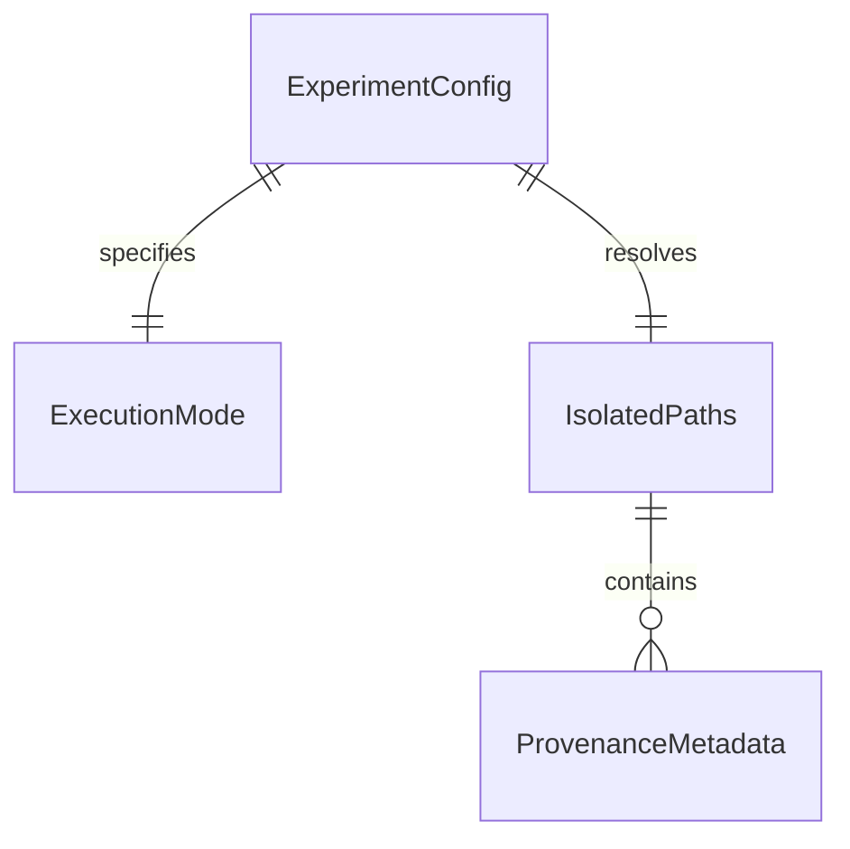

# Global Execution Contract and Reproducibility Isolation

## Problem

Experimental notebooks currently mix synthetic data generation (`torch.randn`, artificial prototypes) and real CIFAR-100 data without isolation. Artifacts generated by `FAST_MODE` smoke runs share paths (`results/`, `embeddings/`, `paper/`) with real benchmark outputs, and downstream artifact generation (`load_or_synthesize_benchmark_results`) silently synthesizes synthetic data when benchmark files are missing.

This creates scientific risk where unverified synthetic numbers can leak into paper figures and tables, and JupyterHub runs fail due to inconsistent relative working directories.

When this ships, `ExecutionMode.SMOKE` and `ExecutionMode.REAL` are strictly isolated across configuration, warning banners, directory paths, and provenance metadata. REAL mode raises explicit errors instead of falling back to synthetic fixtures.

## Flow

1. notebook or pipeline entrypoint -> `src/utils/experiment_config.py` (new, door 1) - loads or initializes `ExperimentConfig`
2. `src/utils/experiment_config.py` (new, door 1) -> validates `ExecutionMode` and resolves absolute paths anchored to repo root
3. entrypoint -> `print_execution_banner()` in `src/utils/experiment_config.py` (new, door 1) - prints explicit warning banner to stdout
4. pipeline runner -> `get_isolated_paths()` in `src/utils/experiment_config.py` (new, door 1) - returns mode-specific subdirectories
5. artifact saver -> `save_provenance_metadata()` in `src/utils/experiment_config.py` (new, door 1) - writes JSON provenance sidecar
6. artifact loader -> `validate_provenance_metadata()` in `src/utils/experiment_config.py` (new, door 1) - enforces mode and synthetic data constraints
7. out: `200` with isolated artifacts and immutable execution contract

## Impact

| Front | What changes |
| --- | --- |
| domain | new terms: `ExecutionMode.SMOKE` (pipeline testing with isolated synthetic fixtures) and `ExecutionMode.REAL` (strict scientific experimentation with CIFAR-100) |
| stored data | directory layout gains isolated subtrees: `embeddings/{mode}/`, `results/{mode}/`, `results/legacy/`, `checkpoints/{mode}/`; existing files in `results/` safely migrated to `results/legacy/` |
| configuration | centralized dataclass `ExperimentConfig` replaces disparate ad-hoc variables across notebooks |

## Relations

One-way constraints: `ExecutionMode` is immutable once set in an execution session; `ProvenanceMetadata.synthetic_data` must be false for any artifact consumed in `ExecutionMode.REAL`.

## Surface

| Route | In | Out | Status |
| --- | --- | --- | --- |
| `ExperimentConfig.from_dict()` | dict with mode, seed, dataset | `ExperimentConfig` instance | `200`, `400`, `422` |
| `print_execution_banner()` | `ExperimentConfig`, notebook name | formatted banner text | `200` |
| `get_isolated_paths()` | `ExperimentConfig`, repo root | `IsolatedPaths` instance | `200` |
| `save_provenance_metadata()` | target path, `ExperimentConfig`, extra dict | metadata path | `200`, `400` |
| `validate_provenance_metadata()` | metadata path, expected mode | validated metadata dict | `200`, `409`, `422` |

## Landing

| One-way door | Literal shape | Alternative rejected |
| --- | --- | --- |
| Centralized `ExecutionMode` enum | `class ExecutionMode(str, Enum): SMOKE = "smoke"; REAL = "real"` | boolean flags (`is_smoke`, `fast_mode`) - prone to ambiguous intermediate states |
| Subdirectory isolation layout | Subdirectories `real/` and `smoke/` under each asset category root | file suffix tags (e.g. `results_smoke.json`) - easily polluted and risks glob cross-talk |
| Immutable execution contract | Mode validation check preventing reassignment once set in a process session | dynamic runtime mode switching - violates experimental purity |
| Path resolution root anchoring | `find_repo_root()` locating `.git` or `pyproject.toml` | `os.getcwd()` - breaks when Jupyter notebooks execute inside `notebooks/` directory |

- Nothing else in this change is hard to reverse

## Criteria

### S1: Centralized Configuration and Mode Validation (P1)

Centralized `ExperimentConfig` enforces valid modes and prevents fallback in REAL mode.

**Acceptance Criteria**

1. WHEN initialized with valid parameters THEN the system SHALL enforce `execution_mode` as either `ExecutionMode.SMOKE` or `ExecutionMode.REAL`
2. IF an unknown or invalid `execution_mode` string is provided THEN the system SHALL raise a `ValueError`
3. WHERE `execution_mode` is set to `ExecutionMode.REAL` the system SHALL set `synthetic_fallback_enabled` to `False`
4. WHILE a process session has an active `ExecutionMode` any attempt to reassign the execution mode to a different value SHALL raise an `IllegalStateError`

### S2: Execution Banner Notification (P1)

Explicit ASCII banner is printed at startup of any notebook or pipeline script.

**Acceptance Criteria**

1. WHEN `print_execution_banner` is called with `ExecutionMode.SMOKE` THEN the system SHALL output a banner containing `SMOKE TEST — SYNTHETIC/TEST EXECUTION` and `NOT VALID FOR SCIENTIFIC REPORTING`
2. WHEN `print_execution_banner` is called with `ExecutionMode.REAL` THEN the system SHALL output a banner containing `EXPERIMENT MODE: REAL` and `Synthetic fallback: DISABLED`
3. WHEN `print_execution_banner` is called THEN the system SHALL display the active notebook name, active execution mode, and target output directory

### S3: Directory Isolation and Path Anchoring (P1)

Mode paths are strictly isolated and relative paths resolve against repository root.

**Acceptance Criteria**

1. WHEN `get_isolated_paths` is called with `ExecutionMode.SMOKE` THEN the system SHALL return directory paths rooted in `embeddings/smoke/`, `results/smoke/`, and `checkpoints/smoke/`
2. WHEN `get_isolated_paths` is called with `ExecutionMode.REAL` THEN the system SHALL return directory paths rooted in `embeddings/real/`, `results/real/`, and `checkpoints/real/`
3. WHEN resolving project paths THEN the system SHALL anchor relative paths to the detected repository root containing `pyproject.toml`
4. WHEN initializing results directories THEN the system SHALL preserve existing legacy outputs by establishing `results/legacy/` and SHALL NOT overwrite existing legacy files

### S4: Provenance Metadata Verification (P1)

Sidecar metadata is persisted and enforced on all artifact loads.

**Acceptance Criteria**

1. WHEN `save_provenance_metadata` is called THEN the system SHALL serialize a JSON file containing `execution_mode`, `dataset`, `seed`, `synthetic_data`, `git_commit`, and `timestamp_utc`
2. IF `validate_provenance_metadata` is called in `ExecutionMode.REAL` and `synthetic_data` is `True` or `execution_mode` is `smoke` THEN the system SHALL raise a `ValueError`
3. IF `validate_provenance_metadata` is called for a missing metadata file in `ExecutionMode.REAL` THEN the system SHALL raise a `FileNotFoundError`

## Out of scope

| Item | Why |
| --- | --- |
| Rewriting MCTS tree algorithms | Belongs to Phase 2 and Phase 3 of the roadmap |
| Modifying LaTeX document structure | Belongs to Phase 5 paper artifact integration |
| Executing full multi-hour REAL GPU benchmarks | Prohibited during development; validation uses fast smoke runs and unit tests |

## Assumptions

| Assumption | Chosen default | Rationale | Confirmed? |
| --- | --- | --- | --- |
| Module location | `src/utils/experiment_config.py` | Explicitly recommended in `ROADMAP_Improvements.md` section 1.1 | y |
| Default execution mode | `ExecutionMode.REAL` | Explicitly mandated by section 1.1 of `ROADMAP_Improvements.md` | y |
| Metadata file extension | `.meta.json` | Co-locates cleanly alongside artifact files (e.g. `data.pt.meta.json` or `dataset_meta.json`) | y |

Open questions: none

## Observable

| Surface | Decisions | Resolution |
| --- | --- | --- |
| `ExperimentConfig` | validation errors, default values | raises `ValueError` on bad inputs, default mode is `REAL` |
| `print_execution_banner` | verbosity and formatting | prints ASCII banner once per notebook or CLI entrypoint |
| `validate_provenance_metadata` | rejection behavior | raises `ValueError` on mode mismatch or synthetic leakage in REAL mode |

## Sources

- `ROADMAP_Improvements.md` (binding)
- `ROADMAP.md` (non-binding context)
