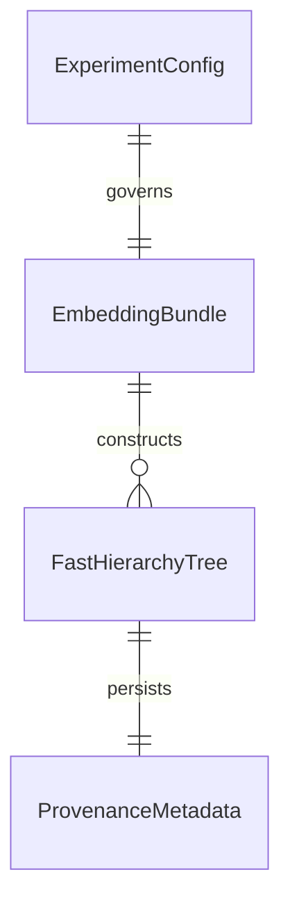

# Notebooks 00, 01, and 02 Reproducibility and Mode Isolation

## Problem

Notebooks 00, 01, and 02 currently employ ad-hoc toggles such as `FAST_MODE` and silent synthetic fallbacks when embeddings or datasets are absent. Notebook 00 unconditionally generates `torch.randn` features and images in its cells, notebook 02 synthesizes synthetic prototype embeddings if `cifar100_resnet18.pt` is missing, and none of them record provenance metadata or isolate artifacts into mode-segregated directories.

This creates scientific risk of silent data contamination and prevents reliable unattended execution in remote JupyterHub environments.

When this ships, notebooks 00, 01, and 02 conform strictly to the global `ExecutionMode` contract. REAL mode requires real CIFAR-100 data, raises explicit `FileNotFoundError` without fallback, and writes isolated artifacts with `.meta.json` sidecars; SMOKE mode validates the pipeline end-to-end using explicitly isolated synthetic fixtures.

## Flow

1. notebook entrypoint cell -> `src/utils/experiment_config.py` (exists) - initializes `ExperimentConfig` and emits banner
2. notebook 01 -> `src/data/extract_embeddings.py` (exists) - extracts real embeddings or generates synthetic smoke fixtures
3. notebook 01 -> `save_provenance_metadata()` in `src/utils/experiment_config.py` (exists) - writes `.meta.json` sidecar
4. notebook 02 -> `validate_provenance_metadata()` in `src/utils/experiment_config.py` (exists) - verifies embedding cache provenance
5. notebook 02 -> `src/trees/confusion_tree.py` (exists) - constructs trees with configurable linkage and exports to isolated path
6. notebook 00 -> orchestrates pipeline stages 0-6 strictly in designated mode without cross-talk
7. out: `200` with isolated trees, embeddings, and provenance metadata

## Impact

| Front | What changes |
| --- | --- |
| domain | notebooks 00, 01, and 02 conform to `ExecutionMode.REAL` vs `ExecutionMode.SMOKE` |
| stored data | embeddings stored in `embeddings/smoke/` and `embeddings/real/`; trees stored in `embeddings/{mode}/trees/` |
| methodology | `build_confusion_tree` supports configurable linkage (`method="ward"` default vs `method="average"`) |

## Relations

One-way constraints: In `ExecutionMode.REAL`, `EmbeddingBundle` must come from CIFAR-100 with `synthetic_data=False`; trees generated in SMOKE mode cannot be read by downstream REAL benchmarks.

## Surface

| Route | In | Out | Status |
| --- | --- | --- | --- |
| `extract_or_generate_embeddings()` | `ExperimentConfig`, data dir, cache path | validated embedding bundle | `200`, `404`, `422` |
| `build_confusion_tree()` | confusion matrix, class-to-indices, linkage method | `FastHierarchyTree` | `200`, `422` |
| `execute_notebook()` | notebook path, `ExperimentConfig` | execution dictionary | `200`, `400` |

## Landing

| One-way door | Literal shape | Alternative rejected |
| --- | --- | --- |
| Explicit mode cell at notebook startup | First executable cell defines `EXECUTION_MODE = ExecutionMode.REAL` | command-line argument injection only - less ergonomic in interactive JupyterHub |
| Strict failure on missing CIFAR-100 in REAL | `raise FileNotFoundError("Real CIFAR-100 dataset missing...")` | silent fallback to `torch.randn` - contaminates experimental results |
| Configurable linkage parameter in confusion tree | `build_confusion_tree(..., linkage_method="ward")` | hardcoded Ward linkage - prevents comparison with Average linkage on confusion dissimilarities |
| Tree artifact isolated directory | Subdirectory `embeddings/{mode}/trees/` | flat `embeddings/trees/` - causes collision between smoke and real trees |

- Nothing else in this change is hard to reverse

## Criteria

### S1: Notebook 01 Data Pipeline Isolation (P1)

Notebook 01 and embedding extraction isolate outputs by execution mode and eliminate silent fallbacks.

**Acceptance Criteria**

1. WHEN `extract_or_generate_embeddings` is called in `ExecutionMode.REAL` and CIFAR-100 is absent THEN the system SHALL raise a `FileNotFoundError`
2. WHEN `extract_or_generate_embeddings` is called in `ExecutionMode.SMOKE` THEN the system SHALL generate a deterministic synthetic embedding bundle and save it to `embeddings/smoke/`
3. WHEN `extract_or_generate_embeddings` saves an embedding bundle THEN the system SHALL write a `.meta.json` sidecar with matching `execution_mode` and `synthetic_data` flags
4. WHILE notebook 01 executes the system SHALL display the mandatory ASCII execution banner in its initial cell output

### S2: Notebook 02 Tree Construction and Methodological Linkage (P1)

Notebook 02 constructs and serializes semantic and confusion trees into isolated directories with provenance verification.

**Acceptance Criteria**

1. WHEN notebook 02 loads embeddings in `ExecutionMode.REAL` THEN the system SHALL validate the provenance metadata and reject synthetic fixtures with status 422
2. WHEN `build_confusion_tree` is called with `linkage_method="ward"` THEN the system SHALL compute Ward hierarchical clustering matching historical behavior
3. WHEN `build_confusion_tree` is called with `linkage_method="average"` THEN the system SHALL compute Average linkage directly on the condensed confusion distance matrix
4. WHEN tree artifacts are saved in notebook 02 THEN the system SHALL serialize them into `embeddings/{mode}/trees/` alongside valid provenance metadata
5. The system SHALL verify that serialized trees preserve index integrity, leaf counts, and non-empty instance pools upon re-loading

### S3: Notebook 00 Master Pipeline Orchestration (P1)

Notebook 00 orchestrates all pipeline stages in strict accordance with the global execution mode contract.

**Acceptance Criteria**

1. WHEN notebook 00 is executed with `ExecutionMode.SMOKE` THEN the system SHALL run all stages using exclusively smoke fixtures and write outputs strictly to smoke directories
2. IF notebook 00 is executed in `ExecutionMode.REAL` and any real stage dependency is missing THEN the system SHALL halt execution with an explicit error
3. The system SHALL reject any execution where a notebook attempts to modify `ExecutionMode` mid-pipeline with status 409

## Out of scope

| Item | Why |
| --- | --- |
| Rewriting MCTS sampling agents in `src/mcts/agent.py` | Belongs to Phase 3 |
| Redesigning ResNet-18 E2E vision model architecture | Belongs to Phase 4 |
| Modifying paper artifact compilation in `paper/` | Belongs to Phase 5 |

## Assumptions

| Assumption | Chosen default | Rationale | Confirmed? |
| --- | --- | --- | --- |
| Synthetic smoke dataset size | 500 samples (5 per class across 100 classes) | Ensures complete 100-class coverage for tree building in < 2 seconds | y |
| Default confusion tree linkage | `"ward"` | Preserves exact historical benchmark equivalence while enabling `"average"` comparison | y |
| Notebook mode selector variable | `EXECUTION_MODE = ExecutionMode.REAL` | Clean, standardized variable across all 6 notebooks | y |

Open questions: none

## Observable

| Surface | Decisions | Resolution |
| --- | --- | --- |
| `extract_or_generate_embeddings` | behavior on missing data in REAL mode | raises `FileNotFoundError`, never falls back |
| `build_confusion_tree` | supported linkage methods | accepts `"ward"` and `"average"`, raises `ValueError` on unknown methods |
| Notebook execution cells | mode selection | initial code cell sets `EXECUTION_MODE` and calls `print_execution_banner` |

## Sources

- `ROADMAP_Improvements.md` (binding)
- `ROADMAP.md` (non-binding context)
