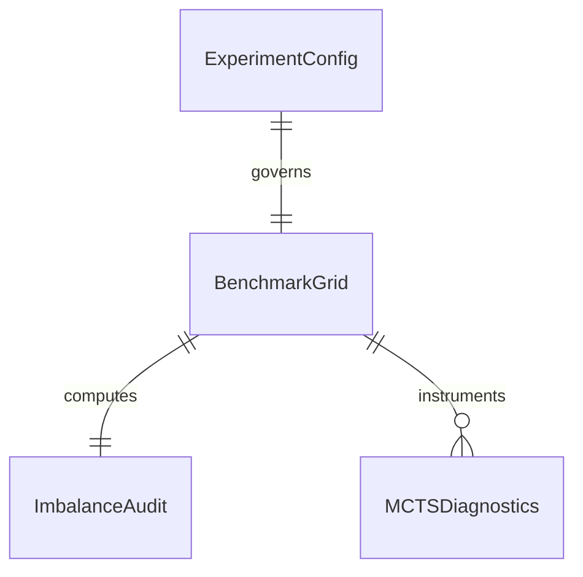

# Tier-1 Benchmarks: Real Data Integration, Diagnostics, and Reproducibility

## Problem

Currently `notebooks/03_tier1_mcts_benchmarks.ipynb` contains a silent fallback that synthesizes random prototype embeddings when `cifar100_resnet18.pt` is missing. Benchmark results are exported without execution mode segregation into a flat `results/` directory, the 1:50 class imbalance ratio lacks an explicit audit distinguishing dataset availability from minibatch sampling rates, Scenario 2 multiclass results lack granular per-class visitation and coverage diagnostics, and announced sensitivity analyses for exploration parameter $c$ and momentum $\alpha$ are absent.

This creates scientific risk where unverified synthetic numbers can pollute benchmark tables, and experimental claims lack necessary diagnostic evidence.

When this ships, notebook 03 conforms strictly to the global `ExecutionMode` contract. REAL mode rejects missing embeddings with `FileNotFoundError` and outputs to `results/real/`; SMOKE mode uses isolated smoke fixtures and outputs to `results/smoke/`. Benchmark runs record complete imbalance audits (available vs batch ratios), computational budget equivalence, Scenario 2 visitation and coverage diagnostics, and full hyperparameter sensitivity analyses.

## Flow

1. notebook 03 cell 1 -> `src/utils/experiment_config.py` (exists) - initializes `ExperimentConfig` and outputs banner
2. notebook 03 cell 3 -> `load_embedding_cache()` in `src/data/extract_embeddings.py` (exists) - loads mode-segregated embeddings with provenance validation
3. notebook 03 cell 5 -> `run_benchmark()` in `src/training/benchmark_runner.py` (exists) - executes Axis 1 sampler benchmark with imbalance audit
4. notebook 03 cell 7 -> `run_benchmark()` in `src/training/benchmark_runner.py` (exists) - executes Axis 2 tree ablation
5. notebook 03 cell 9 -> `run_benchmark()` in `src/training/benchmark_runner.py` (exists) - executes Scenario 2 with multiclass diagnostics
6. notebook 03 -> `run_sensitivity_ablation()` in `src/training/benchmark_runner.py` (new, door 1) - executes $c$ and $\alpha$ sensitivity grid
7. out: `200` with per-seed and aggregated results JSONs, summary CSVs, and `.meta.json` provenance sidecars in isolated results directory

## Impact

| Front | What changes |
| --- | --- |
| domain | Tier-1 benchmarks strictly segregated by `ExecutionMode.REAL` vs `ExecutionMode.SMOKE` |
| stored data | benchmark outputs stored in `results/{mode}/`, legacy files preserved in `results/legacy/` |
| provenance | every exported result contains mode, dataset, seed list, imbalance audit, and diagnostics |

## Relations

One-way constraints: In `ExecutionMode.REAL`, benchmarks must consume real CIFAR-100 embeddings with `synthetic_data=False`; computational budget across all samplers must maintain equivalent negative batch sizes.

## Surface

| Route | In | Out | Status |
| --- | --- | --- | --- |
| `run_benchmark()` | scenario, train/test tensors, strategies, seeds, output_dir, config | benchmark result dict | `200`, `400`, `422` |
| `run_sensitivity_ablation()` | train/test tensors, c_values, alpha_values, output_dir, config | sensitivity result dict | `200`, `422` |
| `audit_scenario1_imbalance()` | split, pos_batch_size, neg_batch_size, num_steps | ImbalanceAudit dict | `200` |

## Landing

| One-way door | Literal shape | Alternative rejected |
| --- | --- | --- |
| Elimination of synthetic prototype fallback in REAL | `raise FileNotFoundError("Real CIFAR-100 embeddings not found...")` | silent random prototype synthesis - hides missing dataset dependencies |
| Imbalance audit data structure | Dictionary with `available_positives`, `available_negatives`, `batch_ratio`, `cumulative_ratio` | undocumented implicit ratio - leads to methodological ambiguity in reporting |
| Scenario 2 multiclass diagnostics tracking | Log per-class visit count, visit entropy, unvisited classes, class recall | reporting only final macro-F1 - conceals severe class collapse or unvisited leaves |
| Sensitivity grid runner for $c$ and $\alpha$ | `run_sensitivity_ablation(train_feats, ..., c_vals=(0.5, 1.0, 2.0, 4.0), alpha_vals=(0.1, 0.3, 0.5, 0.7))` | textual placeholder in notebook without executable function |

- Nothing else in this change is hard to reverse

## Criteria

### S1: Mode Enforcement and Synthetic Fallback Elimination (P1)

Notebook 03 and benchmark runners isolate outputs by execution mode and eliminate silent fallbacks.

**Acceptance Criteria**

1. WHEN notebook 03 loads embeddings in `ExecutionMode.REAL` and the file is missing THEN the system SHALL raise a `FileNotFoundError`
2. WHEN notebook 03 is executed in `ExecutionMode.SMOKE` THEN the system SHALL load or generate smoke embeddings from `embeddings/smoke/` and save results to `results/smoke/`
3. WHEN `run_benchmark` writes result JSONs THEN the system SHALL write a `.meta.json` sidecar containing `execution_mode`, `dataset`, `seed`, and `synthetic_data`
4. WHILE notebook 03 executes the system SHALL display the mandatory ASCII execution banner in its initial cell output

### S2: Scenario 1 Imbalance Audit and Budget Equivalence (P1)

Scenario 1 benchmarks explicitly audit imbalance parameters and computational budget equivalence.

**Acceptance Criteria**

1. WHEN `audit_scenario1_imbalance` is called THEN the system SHALL compute and log `available_positives`, `available_negatives`, `batch_ratio`, and `cumulative_ratio`
2. WHEN `run_benchmark` executes Scenario 1 THEN the system SHALL verify that Uniform, OHEM, Strict GiantHunter, and Enhanced MCTS all use identical total negative batch size $K_{\text{neg}} = 48$
3. WHEN Scenario 1 results are serialized THEN the system SHALL embed the imbalance audit dictionary inside the exported JSON artifact

### S3: Scenario 2 Multiclass Diagnostics and Coverage (P1)

Scenario 2 multiclass benchmarks track granular MCTS search dynamics and class coverage.

**Acceptance Criteria**

1. WHEN `run_benchmark` executes Scenario 2 with MCTS THEN the system SHALL instrument and record visit distribution per class, unvisited classes count, and visitation entropy
2. WHEN Scenario 2 results are exported THEN the system SHALL serialize class coverage percentage and per-class recall array within the result dictionary

### S4: Hyperparameter Sensitivity and Export Integrity (P1)

Hyperparameter sensitivity analyses are fully implemented and exported with individual seed reproducibility.

**Acceptance Criteria**

1. WHEN `run_sensitivity_ablation` is called THEN the system SHALL evaluate exploration parameter $c \in \{0.5, 1.0, 2.0, 4.0\}$ and momentum $\alpha \in \{0.1, 0.3, 0.5, 0.7\}$
2. WHEN sensitivity results are generated THEN the system SHALL serialize `tier1_hyperparameter_sensitivity.json` into the isolated results directory
3. The system SHALL export both individual per-seed results and aggregated statistical summaries (mean, std) reproducible from individual runs

## Out of scope

| Item | Why |
| --- | --- |
| Tier-2 CNN E2E raw image training | Belongs to Phase 4 |
| Paper LaTeX compilation overhaul | Belongs to Phase 5 |
| Executing full multi-hour 5-seed benchmarks | Prohibited during development; validation uses fast smoke runs and unit tests |

## Assumptions

| Assumption | Chosen default | Rationale | Confirmed? |
| --- | --- | --- | --- |
| Benchmark seeds | `(42, 43, 44, 45, 46)` in REAL mode; `(42,)` in SMOKE mode | Standard 5-seed scientific protocol; single seed for rapid smoke validation | y |
| Benchmark steps | 50 in SMOKE mode; 500 in REAL mode | Fast feedback loop during tests; full convergence scale for production | y |
| Negative batch size $K_{\text{neg}}$ | 48 (with positive batch size 16) | Standard GiantHunter computational budget equivalence across all samplers | y |

Open questions: none

## Observable

| Surface | Decisions | Resolution |
| --- | --- | --- |
| `run_benchmark` | behavior on missing real cache | raises `FileNotFoundError`, never falls back to random prototypes |
| `audit_scenario1_imbalance` | audit fields | logs available positives/negatives, batch ratio, cumulative ratio |
| `run_sensitivity_ablation` | parameter grids | evaluates $c \in \{0.5, 1.0, 2.0, 4.0\}$ and $\alpha \in \{0.1, 0.3, 0.5, 0.7\}$ |

## Sources

- `ROADMAP_Improvements.md` (binding)
- `ROADMAP.md` (non-binding context)
