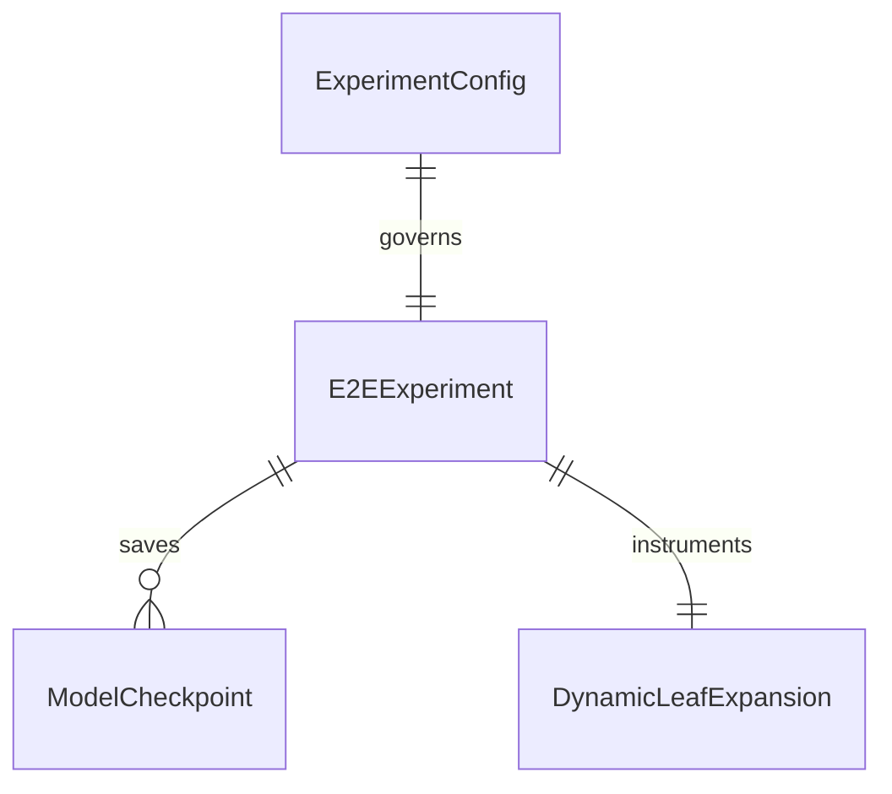

# Tier-2 End-to-End Vision Pipeline: Real CIFAR-100 Images and Dynamic Expansion

## Problem

Currently `notebooks/04_tier2_e2e_and_expansion.ipynb` uses synthetic random tensors (`torch.randn(60, 3, 32, 32)`) as image inputs regardless of experimental intent. Outputs are saved to unversioned flat directories, checkpoints are not isolated into mode-segregated directories (`checkpoints/real/` vs `checkpoints/smoke/`), missing real CIFAR-100 datasets do not raise explicit errors in scientific mode, and dynamic leaf expansion telemetry is not systematically audited with sidecar provenance metadata.

This introduces severe scientific validity issues where claimed end-to-end vision benchmarks reflect noise rather than real CIFAR-100 image feature hierarchies.

When this ships, notebook 04 conforms strictly to the global `ExecutionMode` contract. REAL mode requires genuine CIFAR-100 images, raising `FileNotFoundError` if absent without fallback; SMOKE mode uses isolated small synthetic image fixtures. The end-to-end training engine (`run_e2e_experiment`, `train_e2e_scenario1`, `train_e2e_scenario2`) persists model checkpoints to `checkpoints/{mode}/` and training curves to `results/{mode}/` with `.meta.json` sidecars, fully instrumenting dynamic leaf expansion growth.

## Flow

1. notebook 04 cell 1 -> `src/utils/experiment_config.py` (exists) - initializes `ExperimentConfig` and outputs banner
2. notebook 04 cell 2 -> `load_cifar100_raw_images()` in `src/data/cifar100_images.py` (new, door 1) - loads CIFAR-100 32x32 images or raises `FileNotFoundError` in REAL mode
3. notebook 04 cell 3 -> dynamic leaf expansion comparison via `train_scenario1()` (exists) - audits tree growth and F1 with `enable_leaf_expansion=True`
4. notebook 04 cell 4 -> `run_e2e_experiment()` in `src/training/e2e_trainer.py` (exists) - executes multi-seed ResNet-18 E2E vision training
5. out: `200` with model checkpoints in `checkpoints/{mode}/`, result JSON/CSV in `results/{mode}/`, and `.meta.json` provenance sidecars

## Impact

| Front | What changes |
| --- | --- |
| domain | Tier-2 E2E vision experiments strictly segregated by `ExecutionMode.REAL` vs `ExecutionMode.SMOKE` |
| stored data | Model weights saved to `checkpoints/{mode}/`, metrics saved to `results/{mode}/` with `.meta.json` |
| provenance | Every exported checkpoint and metric file carries provenance metadata |

## Relations

One-way constraints: In `ExecutionMode.REAL`, E2E training must consume genuine CIFAR-100 image tensors; random tensor synthesis is strictly prohibited.

## Surface

| Route | In | Out | Status |
| --- | --- | --- | --- |
| `load_cifar100_raw_images()` | data_dir, split, download, config | tuple of image tensor and label array | `200`, `400`, `422` |
| `run_e2e_experiment()` | config, train/test images, labels, experiment_config | summary dict | `200`, `400`, `422` |
| `train_e2e_scenario1()` | images, labels, strategy, tree, checkpoints_dir | run result dict | `200`, `400`, `422` |

## Landing

| One-way door | Literal shape | Alternative rejected |
| --- | --- | --- |
| Elimination of random image fallback in REAL | `raise FileNotFoundError("Real CIFAR-100 dataset not found...")` | silent random image tensor generation - conceals absent torchvision data |
| Segregated checkpoint paths | `checkpoints/{mode}/tier2_resnet18_{scenario}_{strategy}_seed{seed}.pt` | dumping unversioned `.pt` weights in project root |
| Standardized raw image loader | `load_cifar100_raw_images(data_dir, split, config)` | ad-hoc inlined torchvision calls across notebook cells |

- Nothing else in this change is hard to reverse

## Criteria

### S1: Mode Enforcement and Real CIFAR-100 Image Loading (P1)

Notebook 04 and data loading enforce execution mode segregation and reject synthetic images in REAL mode.

**Acceptance Criteria**

1. WHEN `load_cifar100_raw_images` is called in `ExecutionMode.REAL` and local files are missing with download disabled THEN the system SHALL raise a `FileNotFoundError`
2. WHEN `load_cifar100_raw_images` is called in `ExecutionMode.SMOKE` THEN the system SHALL return deterministic synthetic 32x32 images without downloading external datasets
3. WHEN notebook 04 executes its initial cell THEN the system SHALL declare `EXECUTION_MODE = ExecutionMode.REAL` and output the standardized banner
4. WHEN notebook 04 runs in `ExecutionMode.SMOKE` THEN all training artifacts SHALL be saved under `results/smoke/` and `checkpoints/smoke/`

### S2: Tier-2 E2E Vision Pipeline and Checkpoint Persistence (P1)

Tier-2 ResNet-18 training persists checkpoints and evaluation results with provenance sidecars.

**Acceptance Criteria**

1. WHEN `run_e2e_experiment` completes THEN the system SHALL write `e2e_scenario_{scenario}_results.json` and a corresponding `.meta.json` sidecar
2. WHEN `train_e2e_scenario1` or `train_e2e_scenario2` is executed with `checkpoints_dir` THEN the system SHALL serialize the best model weights to disk
3. WHEN `run_e2e_experiment` runs with multiple seeds THEN the system SHALL record per-seed metrics and compute paired statistical tests against the reference strategy

### S3: Dynamic Leaf Expansion and Tree Growth Auditing (P1)

Dynamic leaf expansion by entropy sub-clustering is benchmarked and verified with structural tree integrity.

**Acceptance Criteria**

1. WHEN `train_scenario1` or `train_e2e_scenario1` runs with `enable_leaf_expansion=True` and visits exceed `split_threshold` THEN the system SHALL increase the number of leaves
2. WHEN a leaf node is dynamically expanded THEN the resulting tree SHALL pass `tree.validate_tree()` with valid parent-child relationships and leaf masks
3. WHEN dynamic expansion is evaluated in notebook 04 THEN the system SHALL output initial vs final leaf counts and macro-F1 comparison

## Out of scope

| Item | Why |
| --- | --- |
| Paper LaTeX compilation | Belongs to Phase 5 |
| Full 200-epoch CNN training on GPU | Prohibited during development; validation uses fast smoke runs and unit tests |
| Video / Audio dataloaders | Project scope is CIFAR-100 image classification |

## Assumptions

| Assumption | Chosen default | Rationale | Confirmed? |
| --- | --- | --- | --- |
| ResNet-18 image dimensions | `32x32` pixels with 3 RGB channels | Standard native CIFAR-100 resolution | y |
| E2E test steps | 10 in SMOKE mode; 100 in REAL mode | Fast feedback during unit tests; full verification in production | y |
| Checkpoint format | Standard PyTorch `.pt` state dict | Clean interoperability with torchvision and torch.load | y |

Open questions: none

## Observable

| Surface | Decisions | Resolution |
| --- | --- | --- |
| `load_cifar100_raw_images` | behavior on missing dataset | raises `FileNotFoundError` in REAL, synthesizes fixtures in SMOKE |
| `run_e2e_experiment` | checkpoint location | stores model weights into `checkpoints/{mode}/` with metadata |
| `enable_leaf_expansion` | validation trigger | validates tree invariant after dynamic sub-cluster creation |

## Sources

- `ROADMAP_Improvements.md` (binding)
- `ROADMAP.md` (non-binding context)
