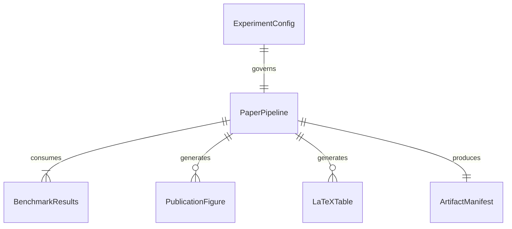

# Paper Artifacts, Real Benchmark Ingestion, and Auditable Provenance

## Problem

Currently `src/utils/paper_artifacts.py` and `notebooks/05_paper_artifacts.ipynb` feature a silent fallback in `load_or_synthesize_benchmark_results`: if benchmark summary files are missing, synthetic data from a normal distribution (`rng.normal(...)`) is silently generated and passed to figure and table generation, even in REAL mode. Furthermore, artifacts are saved directly into `paper/figures/` and `paper/tables/` regardless of execution mode, risking contamination of final publication documents with synthetic data. In addition, actual benchmark JSON files produced by notebooks 03 and 04 (`tier1_axis1_samplers.json`, `tier1_scenario2_curriculum.json`, `tier1_benchmark_summary.json`) are not systematically ingested using validated schemas, and there is no provenance manifest linking generated publication figures/tables to input file SHA-256 hashes, git commits, and execution modes.

When this ships, `src/utils/paper_artifacts.py` and notebook 05 conform strictly to the global `ExecutionMode` contract. REAL mode requires genuine benchmark JSON results from `results/real/`, raising `FileNotFoundError` if absent without fallback; SMOKE mode generates watermarked demonstration figures saved strictly into `results/smoke/paper/`. An auditable `artifact_manifest.json` is generated for every run, tracking artifact names, source file SHA-256 hashes, execution mode, timestamp, and git commit.

## Flow

1. notebook 05 cell 1 -> `src/utils/experiment_config.py` (exists) - initializes `ExperimentConfig` and outputs banner
2. notebook 05 cell 3 -> `load_paper_metadata()` in `src/utils/paper_artifacts.py` (exists) - loads publication title, authors, institution, and abstract
3. notebook 05 cell 5 -> `load_or_synthesize_benchmark_results()` in `src/utils/paper_artifacts.py` (door 1) - ingests real benchmark JSON files in REAL mode or raises `FileNotFoundError`; synthesizes watermarked fixtures in SMOKE mode
4. notebook 05 cell 5 -> `generate_all_paper_artifacts()` in `src/utils/paper_artifacts.py` (door 2) - generates PDF/PNG figures and LaTeX tables in mode-segregated directories, writing `artifact_manifest.json` (door 3)
5. notebook 05 cell 9 -> `compile_paper()` in `src/utils/paper_artifacts.py` (exists) - compiles `paper/main.tex` and validates resulting PDF

## Impact

| Front | What changes |
| --- | --- |
| domain | Paper figure/table generation strictly governed by `ExecutionMode.REAL` vs `ExecutionMode.SMOKE` |
| stored data | Output paths segregated: `paper/figures/` and `paper/tables/` (REAL) vs `results/smoke/paper/` (SMOKE) |
| provenance | `artifact_manifest.json` records SHA-256 hashes of input files, git commit, mode, and timestamps |

## Relations

One-way constraints: In `ExecutionMode.REAL`, `load_or_synthesize_benchmark_results` must ingest real benchmark JSON files and MUST NEVER generate synthetic data or silent fallbacks.

## Surface

| Route | In | Out | Status |
| --- | --- | --- | --- |
| `load_real_benchmark_results()` | results_dir | structured benchmark dict | `200`, `400`, `422` |
| `load_or_synthesize_benchmark_results()` | results_dir, seed, config | structured benchmark dict | `200`, `400`, `422` |
| `generate_all_paper_artifacts()` | results_dir, paper_dir, metadata_path, config | dict of generated paths | `200`, `400`, `422` |
| `generate_artifact_manifest()` | output_dir, artifacts, source_files, mode, git_commit | manifest Path | `200`, `400`, `422` |
| `compile_paper()` | paper_dir, engine, runs | compiled PDF Path | `200`, `400`, `422` |

## Landing

| One-way door | Literal shape | Alternative rejected |
| --- | --- | --- |
| Rejection of synthetic fallback in REAL | `raise FileNotFoundError("Real benchmark results not found at...")` | silent random data generation - disguises missing experimental evidence |
| Mode-segregated output directories | `paper_dir = root / "paper"` (REAL) vs `root / "results/smoke/paper"` (SMOKE) | mixing smoke demonstration figures with real manuscript figures |
| Auditable provenance manifest | `artifact_manifest.json` with SHA-256 hashes and git commit | unversioned figures without cryptographic traceability |

- Nothing else in this change is hard to reverse

## Criteria

### S1: Mode Enforcement and Real Benchmark Ingestion (P0)

Artifact generation enforces execution mode segregation and strictly rejects synthetic data in REAL mode.

**Acceptance Criteria**

1. WHEN `load_or_synthesize_benchmark_results` is called in `ExecutionMode.REAL` and required benchmark JSON files are missing THEN the system SHALL raise a `FileNotFoundError` detailing missing files
2. WHEN `load_or_synthesize_benchmark_results` is called in `ExecutionMode.SMOKE` THEN the system SHALL return deterministic synthetic distributions labeled as smoke data
3. WHEN `load_real_benchmark_results` is called with valid benchmark JSON files (`tier1_axis1_samplers.json`, `tier1_scenario2_curriculum.json`, `tier1_benchmark_summary.json`) THEN the system SHALL parse and normalize them into the expected benchmark schema
4. WHEN notebook 05 executes its initial cell THEN the system SHALL declare `EXECUTION_MODE = ExecutionMode.REAL` and print the standardized banner

### S2: Publication Figures, Tables, and Provenance Manifest (P0)

Publication figures and LaTeX tables are exported to mode-segregated paths and verified with a provenance manifest.

**Acceptance Criteria**

1. WHEN `generate_all_paper_artifacts` is called THEN the system SHALL generate convergence curves, tree visitation heatmap, hyperparameter sensitivity plots, and LaTeX booktabs tables
2. WHEN running in `ExecutionMode.SMOKE` THEN generated figures SHALL include a visible `SMOKE TEST — NOT FOR PUBLICATION` watermark/indicator and save to `results/smoke/paper/`
3. WHEN running in `ExecutionMode.REAL` THEN generated figures and tables SHALL save to `paper/figures/` and `paper/tables/` without watermark
4. WHEN `generate_all_paper_artifacts` completes THEN the system SHALL write `artifact_manifest.json` recording generated artifacts, source file SHA-256 hashes, execution mode, timestamp, and git commit

### S3: Manuscript Compilation and Notebook 05 Standard (P1)

Manuscript compilation and notebook 05 conform to project path resolution and error handling.

**Acceptance Criteria**

1. WHEN `compile_paper` is called and `pdflatex` is not installed on PATH THEN the system SHALL raise a `RuntimeError` or `FileNotFoundError` without reporting false success
2. WHEN notebook 05 runs in either mode THEN all paths SHALL resolve relative to project root without cwd dependence

## Out of scope

| Item | Why |
| --- | --- |
| Rewriting LaTeX manuscript prose | Paper text is already written; this feature focuses on data ingestion and artifact generation |
| Running 10-hour full benchmarks during tests | Prohibited during development; test suite uses isolated JSON fixtures |
| Non-CIFAR-100 datasets | Project scope is CIFAR-100 image classification |

## Assumptions

| Assumption | Chosen default | Rationale | Confirmed? |
| --- | --- | --- | --- |
| Benchmark JSON location | `results/{mode}/` | Consistent with `IsolatedPaths` contract | y |
| Figure formats | PDF vector + PNG 300 DPI raster | LaTeX compatibility and high-resolution web/notebook preview | y |
| Provenance hash algorithm | SHA-256 | Cryptographic collision resistance for paper audit | y |

Open questions: none

## Observable

| Surface | Decisions | Resolution |
| --- | --- | --- |
| `load_or_synthesize_benchmark_results` | missing real results | raises `FileNotFoundError` in REAL, synthesizes fixtures in SMOKE |
| `generate_all_paper_artifacts` | destination routing | `paper/` in REAL vs `results/smoke/paper/` in SMOKE |
| `generate_artifact_manifest` | source tracking | records SHA-256 checksums of consumed benchmark JSON files |

## Sources

- `ROADMAP_Improvements.md` (binding)
- `ROADMAP.md` (non-binding context)
