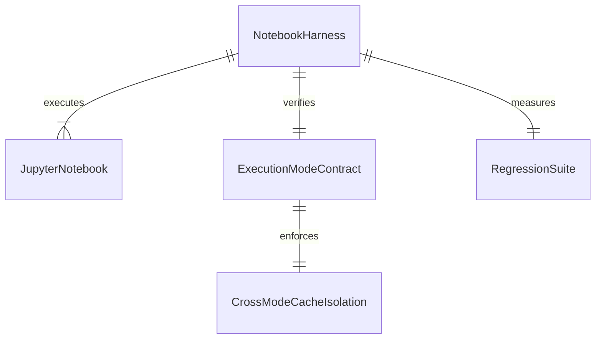

# Automated Regression Testing Suite and End-to-End Notebook Validation

## Problem

While individual unit tests exist across modules, there is no unified automated harness testing all six notebooks (`00_master_end_to_end.ipynb`, `01_data_and_embeddings.ipynb`, `02_tree_construction.ipynb`, `03_tier1_mcts_benchmarks.ipynb`, `04_tier2_e2e_and_expansion.ipynb`, `05_paper_artifacts.ipynb`) executing end-to-end sequentially under `ExecutionMode.SMOKE`. Furthermore, cross-mode cache rejection (REAL rejecting SMOKE cache and SMOKE rejecting REAL cache), strict rejection of SMOKE results by notebook 05 during REAL generation, and a segregated real integration test path have not been codified in a single fast regression suite executing in under 60 seconds.

When this ships, `tests/test_automated_suite_real.py` validates all six notebooks executing end-to-end in SMOKE mode, verifies cross-mode isolation invariants and session immutability (`IllegalStateError`), confirms that notebook 05 in REAL mode strictly rejects SMOKE results, and exercises a labeled reduced real integration path while maintaining a total test suite runtime under 60 seconds.

## Flow

1. test harness -> `run_notebook_smoke()` in `tests/test_automated_suite_real.py` (door 1) - executes notebook cells in isolated sandbox
2. notebook runner -> `notebooks/00` through `notebooks/05` (exists) - sequentially runs in SMOKE mode
3. cross-mode audit -> `validate_provenance_metadata()` and `load_real_benchmark_results()` (door 2) - validates rejection of mismatched caches
4. reduced real test -> `test_reduced_real_integration_path()` (door 3) - executes labeled real pipeline in temporary workspace
5. out: `200` with 100% notebook coverage, zero working-tree pollution, and runtime under 60s

## Impact

| Front | What changes |
| --- | --- |
| domain | Automated regression harness validating all 6 notebooks and cross-mode boundaries |
| stored data | All notebook execution tests run in `tmp_path`, keeping repository pristine |
| provenance | Validates that every notebook and pipeline generates and verifies `.meta.json` sidecars |

## Relations

One-way constraints: In `ExecutionMode.REAL`, all functions must reject `ExecutionMode.SMOKE` caches and raise explicit errors when real data is missing.

## Surface

| Route | In | Out | Status |
| --- | --- | --- | --- |
| `run_notebook_in_smoke()` | notebook_path, tmp_path | execution summary dict | `200`, `400`, `422` |
| `test_cross_mode_cache_rejection()` | test fixture | assertion | `200`, `400`, `422` |
| `test_reduced_real_integration_path()` | test fixture | assertion | `200`, `400`, `422` |

## Landing

| One-way door | Literal shape | Alternative rejected |
| --- | --- | --- |
| Isolated temp workspaces for notebook tests | `tmp_path` based redirection of `paths` | executing notebooks in-place and polluting git working tree |
| Cross-mode cache rejection | `raise ValueError("Cannot load SMOKE cache in REAL mode")` | silent ingestion of synthetic data in scientific mode |
| Fast smoke regression budget | `< 60s` execution time | multi-hour full training runs during routine CI/pytest passes |

- Nothing else in this change is hard to reverse

## Criteria

### S1: End-to-End Notebook Execution in SMOKE Mode (P0)

All six notebooks execute completely and cleanly in SMOKE mode without runtime or syntax errors.

**Acceptance Criteria**

1. WHEN notebooks 00, 01, 02, 03, 04, and 05 execute under `ExecutionMode.SMOKE` THEN all cells SHALL execute successfully without runtime errors
2. WHEN any notebook executes in SMOKE mode THEN all outputs SHALL be confined to `results/smoke/`, `embeddings/smoke/`, and `checkpoints/smoke/`
3. WHEN any notebook executes in SMOKE mode THEN the standardized ASCII warning banner SHALL be printed

### S2: Cross-Mode Cache Rejection and Session Immutability (P0)

Cross-mode cache contamination is strictly prohibited and session execution mode transitions are rejected.

**Acceptance Criteria**

1. WHEN `validate_provenance_metadata` or data loaders in REAL mode encounter a cache tagged with `ExecutionMode.SMOKE` THEN the system SHALL raise a `ValueError` or `FileNotFoundError`
2. WHEN notebook 05 runs in `ExecutionMode.REAL` and only SMOKE results exist THEN generation SHALL fail with `FileNotFoundError` without falling back to synthetic data
3. WHEN `set_active_session_mode` is called with a conflicting mode during an active process session THEN the system SHALL raise an `IllegalStateError`

### S3: Reduced Real Integration Path and Performance SLA (P1)

A labeled reduced real integration path executes without errors, and the entire test suite completes under 60 seconds.

**Acceptance Criteria**

1. WHEN the reduced real integration path is executed with a labeled fixture in REAL mode THEN the training, evaluation, and artifact pipelines SHALL complete successfully
2. WHEN the entire regression test suite is executed via pytest THEN execution time SHALL be under 60 seconds

## Out of scope

| Item | Why |
| --- | --- |
| 100-epoch GPU training on full CIFAR-100 | Prohibited during development; reserved for post-roadmap scientific benchmarking |
| Rewriting notebook visualization logic | Focus is automated regression execution and contract enforcement |
| External cloud execution harnesses | Local pytest and remote JupyterHub execution are already standardized |

## Assumptions

| Assumption | Chosen default | Rationale | Confirmed? |
| --- | --- | --- | --- |
| Notebook execution engine | In-process AST / exec with isolated globals | Fast, reliable, and avoids kernel subprocess overhead | y |
| Regression timeout budget | Under 60 seconds | Required by Phase 6 roadmap specification | y |
| Working tree isolation | All test outputs redirected to `tmp_path` | Preserves git clean state | y |

Open questions: none

## Observable

| Surface | Decisions | Resolution |
| --- | --- | --- |
| `run_notebook_in_smoke` | isolation strategy | redirects `repo_root` to `tmp_path` fixture |
| `validate_provenance_metadata` | mismatch response | raises `ValueError` on mode discrepancy |
| `regression_suite` | execution budget | verified by pytest timer |

## Sources

- `ROADMAP_Improvements.md` (binding)
- `ROADMAP.md` (non-binding context)
