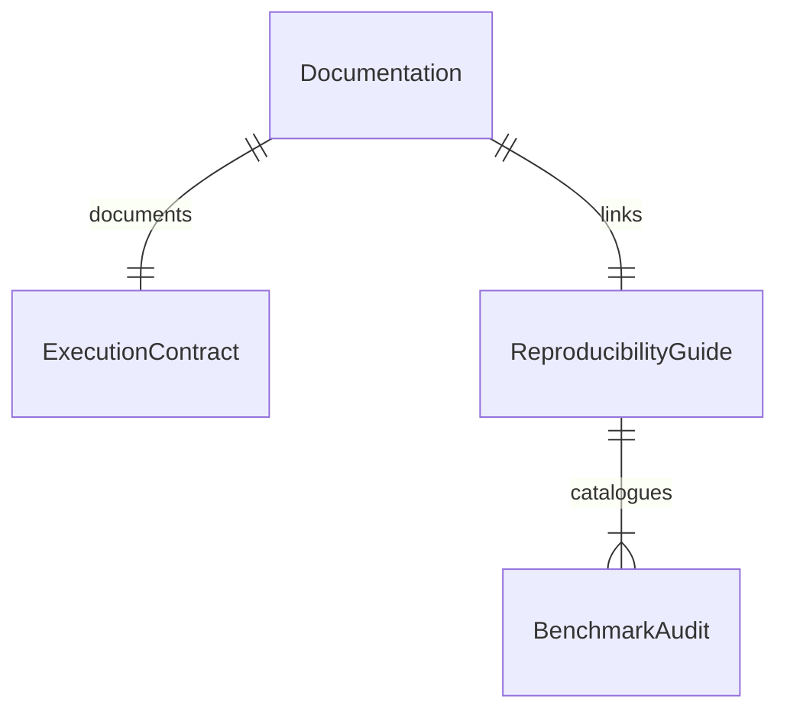

# Scientific Documentation and Experimental Reproducibility Guide

## Problem

The repository `README.md` does not explain the strict two-tier execution mode contract (`ExecutionMode.REAL` vs `ExecutionMode.SMOKE`), directory isolation structure (`results/{mode}/`, `embeddings/{mode}/`, `checkpoints/{mode}/`), execution order, or result versioning rules (`.meta.json` sidecars). In addition, there is no centralized reproducibility guide (`docs/experimental_reproducibility.md`) detailing the transition between historical experiments and validated runs, auditable provenance status, dataset requirements, and known experimental limitations.

When this ships, the root `README.md` provides complete documentation on environment setup, dataset requirements, execution mode semantics, notebook workflow, and figure/table reproduction. A comprehensive `docs/experimental_reproducibility.md` is authored, auditing completed experiments, historical results without provenance, pending benchmark runs, and providing exact commands to reproduce every scientific artifact.

## Flow

1. developer/reviewer -> `README.md` (exists, door 1) - reads execution mode definitions, environment setup, and notebook workflow
2. researcher -> `docs/experimental_reproducibility.md` (new, door 2) - consults historical audit, active benchmarks, and provenance guide
3. test suite -> `tests/test_documentation_and_reproducibility.py` (new, door 3) - programmatically verifies documentation completeness and link integrity
4. out: `200` with 100% documentation coverage of the 7 roadmap phases and zero broken internal file links

## Impact

| Front | What changes |
| --- | --- |
| domain | Comprehensive reproducibility documentation for scientific review and open dissemination |
| stored data | Authoring of `docs/experimental_reproducibility.md` and update of root `README.md` |
| provenance | Explicit categorization of historical vs verified scientific benchmarks |

## Relations

One-way constraints: All documentation must maintain exact fidelity to the implemented codebase and never claim unverified benchmarks as completed scientific findings.

## Surface

| Route | In | Out | Status |
| --- | --- | --- | --- |
| `docs/experimental_reproducibility.md` | markdown content | documentation artifact | `200`, `400`, `422` |
| `README.md` | markdown content | updated project overview | `200`, `400`, `422` |
| `tests/test_documentation_and_reproducibility.py` | test runner | assertion | `200`, `400`, `422` |

## Landing

| One-way door | Literal shape | Alternative rejected |
| --- | --- | --- |
| Explicit historical experiment audit | Clear table of historical vs verified runs in `docs/experimental_reproducibility.md` | deleting or concealing historical files without documentation |
| Explicit execution mode documentation | Step-by-step instructions for `SMOKE` vs `REAL` in `README.md` | omitting mode flags and letting users encounter silent confusion |

- Nothing else in this change is hard to reverse

## Criteria

### S1: Root README Documentation Standard (P0)

The root `README.md` fully documents execution modes, environment setup, directory layout, and reproduction instructions.

**Acceptance Criteria**

1. WHEN `README.md` is inspected THEN it SHALL define both `ExecutionMode.SMOKE` and `ExecutionMode.REAL` semantics
2. WHEN `README.md` is inspected THEN it SHALL document CIFAR-100 dataset requirements, directory layout, and isolated path rules
3. WHEN `README.md` is inspected THEN it SHALL provide instructions for running smoke tests, executing real experiments, and reproducing paper artifacts
4. WHEN `README.md` is inspected THEN it SHALL list known experimental limitations and link to `docs/experimental_reproducibility.md`

### S2: Experimental Reproducibility Guide (P0)

A centralized `docs/experimental_reproducibility.md` guide documents completed experiments, historical audits, and reproduction recipes.

**Acceptance Criteria**

1. WHEN `docs/experimental_reproducibility.md` is inspected THEN it SHALL catalog completed experiments, pending experiments, and historical results lacking sufficient provenance
2. WHEN `docs/experimental_reproducibility.md` is inspected THEN it SHALL document tree geometry methodological decisions (Ward vs Average linkage)
3. WHEN `docs/experimental_reproducibility.md` is inspected THEN it SHALL detail negative mining budget equivalence ($K_{\text{neg}} = 48$) and dynamic leaf expansion criteria
4. WHEN `tests/test_documentation_and_reproducibility.py` executes THEN all documentation assertions SHALL pass

## Out of scope

| Item | Why |
| --- | --- |
| Translation to non-English languages | Project standardization decision AD-003 mandates 100% English documentation |
| Modifying core ML algorithms | Phase 7 is strictly documentation and reproducibility |

## Assumptions

| Assumption | Chosen default | Rationale | Confirmed? |
| --- | --- | --- | --- |
| Guide location | `docs/experimental_reproducibility.md` | Standard location mandated by Phase 7 roadmap | y |
| Link format | GitHub Flavored Markdown relative links | Clean rendering in both IDE and GitHub web view | y |

Open questions: none

## Observable

| Surface | Decisions | Resolution |
| --- | --- | --- |
| `README.md` | execution instructions | documented for both bash CLI and JupyterHub notebooks |
| `experimental_reproducibility.md` | historical results audit | explicitly catalogued in audit table |

## Sources

- `ROADMAP_Improvements.md` (binding)
- `ROADMAP.md` (non-binding context)
