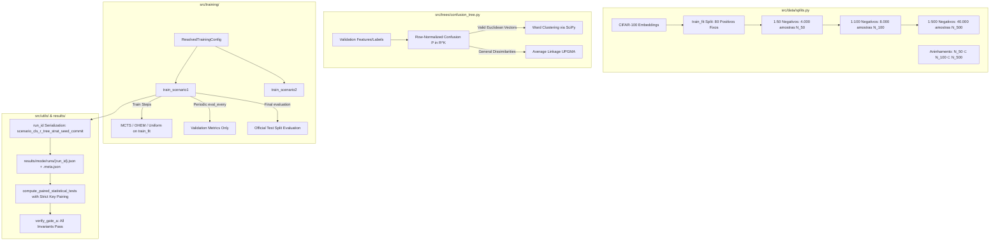

# F17: Fase A — Auditoria e Integridade do Protocolo Experimental Design

**Spec**: `.specs/features/17-fase-a-auditoria-e-integridade/spec.md`  
**Status**: Approved

---

## Architecture Overview

A Fase A estabelece a fundação de integridade científica do projeto `mcts-hnm`, corrigindo três desvios metodológicos fundamentais (desbalanceamento, vazamento de teste e clustering não-euclidiano) e introduzindo persistência atômica granular e governança compartilhada entre runners.



---

## Code Reuse Analysis

### Existing Components to Leverage

| Component | Location | How to Use |
| --------- | -------- | ---------- |
| `IMBALANCE_RATIOS`, `Scenario1Split` | `src/data/splits.py` | Extender para suportar `StratifiedImbalancedSplit` e amostragem aninhada $N_{50} \subset N_{100} \subset N_{500}$ |
| `FastHierarchyTree`, `estimate_validation_confusion_matrix` | `src/trees/confusion_tree.py` | Refatorar para usar vetores euclidianos por linha na árvore Ward e rejeitar `test_features` |
| `train_scenario1`, `train_scenario2` | `src/training/trainer.py` | Modificar avaliação periódica para usar exclusivamente `val_features` |
| `ExperimentConfig`, `ExecutionMode` | `src/utils/experiment_config.py` | Integrar geração de manifesto `generate_run_manifest` e checagem de integridade |
| `compute_paired_statistical_tests` | `src/utils/statistics.py` | Adicionar validação estrita de pareamento de chaves (seed, split, classe, orçamento) |

---

## Components and Interfaces

### 1. Construtor de Splits com Negativos Aninhados (`src/data/splits.py`)

- **Objetivo**: Separar razão real do treino, contagem de positivos únicos e fração do batch.
- **Funções**:
  - `build_stratified_imbalanced_split(fine_labels, target_class, target_positive_count=80, target_neg_pos_ratio=50, seed=42, nested_negative_parent=None) -> StratifiedImbalancedSplit`
  - `build_nested_imbalanced_splits(fine_labels, target_class, target_positive_count=80, ratios=(50, 100, 500), seed=42) -> dict[int, StratifiedImbalancedSplit]`
- **Invariantes**:
  - $N_{\text{pos}} = 80$ idêntico para 50, 100 e 500.
  - $N_{50} \subset N_{100} \subset N_{500}$ com amostragem estratificada proporcional entre as 99 classes negativas.
  - Erro explícito (`ValueError`) se dados forem insuficientes; sem reamostragem em silêncio.

### 2. Segregação Estrita de Dados em Treinamento (`src/training/trainer.py`)

- **Objetivo**: Garantir que dados de teste nunca sejam consultados durante o treinamento.
- **Assinatura revisada de `train_scenario1`**:
  ```python
  def train_scenario1(
      train_features: torch.Tensor,
      train_binary_labels: np.ndarray | torch.Tensor,
      positive_indices: np.ndarray,
      negative_indices: np.ndarray,
      val_features: torch.Tensor,
      val_binary_labels: np.ndarray | torch.Tensor,
      test_features: torch.Tensor | None = None,
      test_binary_labels: np.ndarray | torch.Tensor | None = None,
      ...
  )
  ```
- **Invariantes**:
  - Avaliação periódica em `step % eval_every == 0` roda em `val_features`.
  - Se `val_features` for `None`, lança `ValueError`.
  - Se `test_features` for fornecido, é avaliado estritamente uma vez no fim do treino (no melhor checkpoint de validação ou no último passo, documentado).

### 3. Validação Euclidiana para Ward Clustering (`src/trees/confusion_tree.py`)

- **Objetivo**: Garantir legitimidade matemática da minimização de variância de Ward.
- **Abordagem**:
  - Linhas da matriz de confusão normalizada por linha: $p_i = C_i / \sum_j C_{i,j}$. Cada $p_i$ é uma distribuição em $\mathbb{R}^K$.
  - Como $p_i \in \mathbb{R}^K$, a distância euclidiana $\|p_i - p_j\|_2$ é genuína e livre de distorções métricas ou inversões de Lance-Williams.
  - Aplicar `linkage(P, method="ward", metric="euclidean")`.
  - Para matriz de distâncias de confusão $D \in [0, 1]^{K \times K}$, aplicar `linkage(squareform(D), method="average")` (UPGMA).
  - Rejeitar estritamente uso de dados de teste na calibração da matriz de confusão.

### 4. Configuração Resolvida Compartilhada (`src/training/runner_config.py`)

- **Objetivo**: Unificar governança de hiperparâmetros entre `run_benchmark`, `run_sensitivity_ablation` e `train_scenario1`.
- **Classe**: `ResolvedTrainingConfig`.
- **Invariantes**:
  - Imutável (`frozen=True`).
  - Serializável em dicionário/JSON para inclusão no manifesto e nos logs de cada `run_id`.

### 5. Persistência Atômica por Run ID (`src/training/benchmark_runner.py`)

- **Objetivo**: Cada execução gera seu próprio artefato atômico `results/{mode}/runs/{run_id}.json`.
- **Padrão de `run_id`**:
  `{scenario}_{target_class}_r{ratio}_{tree}_{strategy}_s{seed}_{commit}`
- **Pareamento**:
  - `compute_paired_statistical_tests` exige correspondência exata de `seed`, `split_hash`, `target_class` e `budget`.

### 6. Verificador Gate A (`src/utils/gate_a_verifier.py`)

- **Objetivo**: Função `verify_gate_a()` que executa todas as verificações A1 a A6 programaticamente e retorna 0 se todas passarem.

---

## Risks & Concerns

1. **Risco**: Quebra de compatibilidade em testes existentes que chamavam `train_scenario1` passando `test_features` sem `val_features`.
   - **Mitigação**: `test_features` e `val_features` podem ser mapeados de forma limpa nos testes existentes (passando fixtures de validação dedicadas ou atualizando os testes de forma coordenada).
2. **Risco**: CIFAR-100 tem 500 imagens de treino por classe; após separar 50 para validação, sobram 450 em `train_fit`. Para 80 positivos, 80 * 500 = 40.000 negativos. Como há 99 classes negativas com 450 amostras cada ($99 \times 450 = 44.550$), 40.000 negativos cabem perfeitamente sem reposição!
   - **Mitigação**: O teste unitário de A2 verificará explicitamente que 40.000 cabem em 44.550 e que não há reposição.

---

## Decisions to Record in STATE.md

- **AD-020**: Adoção do protocolo experimental revisado da Fase A com splits estratificados aninhados (1:50, 1:100, 1:500 com 80 positivos fixos), segregação estrita sem vazamento de teste, perfis de confusão euclidianos para Ward clustering e persistência granular por `run_id`.
