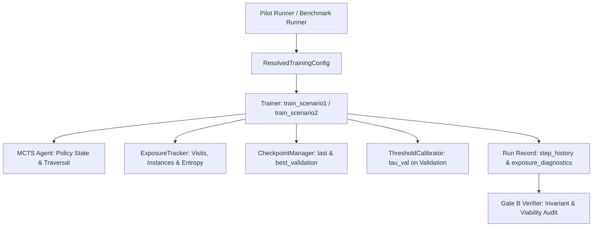

# F18: Fase B — Instrumentação, Observabilidade e Piloto Diagnóstico — Design

**Spec**: `.specs/features/18-fase-b-instrumentacao-e-diagnostico/spec.md`  
**Status**: Draft  

---

## Architecture Overview

A arquitetura da Fase B introduz instrumentação em tempo real no loop de treinamento, diagnóstico contínuo da árvore MCTS, gerenciamento formal de checkpoints com calibração de limiar, e um executor piloto curto acoplado ao Verificador do Gate B.

### Fluxo Operacional:
1. **Passo a passo no Treinador**: Durante o loop de treinamento, cada minibatch reporta classes selecionadas e instâncias ao `ExposureTracker`.
2. **Intervalo de Avaliação**: Métricas completas (`train_loss`, `val_loss`, `val_F1`, `val_AUPRC`, `macro_f1`, `accuracy`, `lr`, tempo) são avaliadas estritamente sobre `val_features` e registradas no `step_history`.
3. **Ponto Ótimo de Validação**: Se a métrica de validação atingir novo pico, `CheckpointManager` atualiza o checkpoint `best_validation`; no último passo, grava `last`.
4. **Calibração de Limiar (Cenário 1)**: As probabilidades de validação calibram o limiar ótimo $\tau_{\text{val}} = \arg\max_\tau \text{F1}_{\text{val}}(\tau)$.
5. **Avaliação Final no Teste**: O teste é avaliado uma única vez reportando F1 com $\tau=0.5$, F1 com $\tau=\tau_{\text{val}}$ e AUPRC.
6. **Auditoria do Gate B**: `verify_gate_b()` inspeciona todos os registros gerados pelo piloto para verificar ausência de NaNs, contagens exatas em 1:500 e completude diagnóstica.

---

## Code Reuse Analysis

### Existing Components to Leverage

| Component | Location | How to Use |
| --------- | -------- | ---------- |
| `FastHierarchyTree` | `src/trees/base_tree.py` | Leitura de contadores de visita, nós e classes-folha |
| `MCTSHNMAgent` | `src/mcts/mcts_agent.py` | Adicionar método `get_policy_diagnostics()` e inspeção de UCB |
| `train_scenario1`, `train_scenario2` | `src/training/trainer.py` | Instrumentar com `ExposureTracker` e `CheckpointManager` |
| `ResolvedTrainingConfig` | `src/training/runner_config.py` | Passar parâmetros de observabilidade e diretório de checkpoints |
| `build_nested_imbalanced_splits` | `src/data/splits.py` | Alimentar o piloto com splits aninhados 1:50, 1:100 e 1:500 |
| `assert_path_mutable` | `src/utils/experiment_config.py` | Proteger diretórios de resultados e persistência de checkpoints |

---

## Components and Interfaces

### 1. Rastreador de Exposição Amostral (`src/training/exposure.py`)

- **Objetivo**: Monitorar a amostragem de instâncias e classes pelos minibatches e calcular métricas agregadas de exposição.
- **Classe**: `ExposureTracker`.
- **Métodos**:
  - `record_batch(class_ids: np.ndarray, instance_indices: np.ndarray, is_gradient: bool = True) -> None`
  - `record_leaf_selection(leaf_id: int) -> None`
  - `compute_diagnostics(val_class_recalls: dict[int, float] | None = None) -> dict[str, Any]`:
    - `total_node_visits`: $N_v$
    - `total_leaf_selections`: $N_l$
    - `total_instances_selected`: $N_s$
    - `unique_instances_selected`: $N_u$
    - `class_exposure_counts`: dict de contagem por classe
    - `normalized_exposure_entropy`: $H_{\text{norm}} \in [0.0, 1.0]$
    - `unexposed_classes_count`: $C_{\text{unexp}}$
    - `worst10_class_recall`: recall médio das 10 classes com pior recall

### 2. Diagnóstico da Política MCTS (`src/mcts/mcts_agent.py`)

- **Objetivo**: Extrair instantâneo detalhado do estado interno de busca da árvore.
- **Função/Método**: `get_mcts_policy_diagnostics(tree: FastHierarchyTree, agent: MCTSHNMAgent) -> dict[str, Any]`.
- **Campos Retornados**:
  - `q_values`: array com estimativas $Q$ por nó
  - `visits`: array com contadores de visitação $N$ por nó
  - `exploration_terms`: array com valores de $U(s, a) = c_{\text{puct}} P(s, a) \frac{\sqrt{\sum N}}{1 + N}$
  - `ucb_scores`: array com $Q + U$
  - `raw_rewards`: últimas recompensas brutas registradas
  - `smoothed_rewards`: recompensas com momentum/suavização

### 3. Gerenciador de Checkpoints (`src/training/checkpoints.py`)

- **Objetivo**: Persistência e restauração determinística de estados de modelo, otimizador, árvore e RNG.
- **Classe**: `CheckpointManager`.
- **Métodos**:
  - `save_checkpoint(checkpoint_type: str, model: torch.nn.Module, optimizer: torch.optim.Optimizer, tree: FastHierarchyTree | None, step: int, metrics: dict, seed_states: dict) -> Path`
  - `load_checkpoint(path: Path, model: torch.nn.Module, optimizer: torch.optim.Optimizer | None = None, tree: FastHierarchyTree | None = None) -> dict`
- **Invariante**: Salva `last.pt` e `best_validation.pt` no diretório configurado (`results/{mode}/checkpoints/`).

### 4. Calibrador de Limiar Binário (`src/utils/metrics.py`)

- **Objetivo**: Encontrar o limiar ótimo $\tau_{\text{val}} \in [0.01, 0.99]$ que maximiza o F1-score no conjunto de validação.
- **Funções**:
  - `calibrate_binary_threshold(val_probs: np.ndarray, val_targets: np.ndarray, num_thresholds: int = 100) -> float`
  - `evaluate_binary_metrics_at_threshold(test_probs: np.ndarray, test_targets: np.ndarray, threshold: float) -> dict[str, float]`

### 5. Executor de Piloto Diagnóstico (`src/training/pilot_runner.py`)

- **Objetivo**: Executar piloto reduzido (2 seeds, $\le 500$ passos) para testar a pipeline de ponta a ponta e validar viabilidade de 1:500.
- **Função**: `run_diagnostic_pilot(output_dir: Path, seeds: tuple[int, ...] = (42, 43), num_steps: int = 200, execution_mode: str = "smoke") -> list[dict]`.

### 6. Verificador do Gate B (`src/utils/gate_b_verifier.py`)

- **Objetivo**: Auditar as execuções do piloto, garantindo ausência de falhas numéricas e conformidade com os critérios do Gate B.
- **Função**: `verify_gate_b(run_records: list[dict] | None = None, pilot_dir: Path | None = None, verbose: bool = True) -> int`.

---

## Risks & Concerns

1. **Risco**: Cálculo de entropia e Worst-10 recall pode introduzir overhead por passo se executado a cada minibatch.
   - **Mitigação**: O `ExposureTracker` apenas incrementa contadores inteiros durante o treino ($O(1)$ por batch). O cálculo de entropia e agregação ocorre estritamente ao final do treino no método `compute_diagnostics()`.
2. **Risco**: No desbalanceamento 1:500, a busca por limiares de decisão pode gerar F1 nulo se as probabilidades forem excessivamente calibradas para zero.
   - **Mitigação**: `calibrate_binary_threshold` varre um grid fino com proteção contra divisão por zero e fallback explícito para $\tau=0.5$ caso nenhuma predição positiva ocorra.
3. **Risco**: O checkpoint completo incluindo tensores de modelo e buffers de árvore pode consumir espaço excessivo em disco em execuções de muitas seeds.
   - **Mitigação**: Checkpoints são salvos apenas para `last` e `best_validation` (máximo 2 arquivos `.pt` por `run_id`), com exclusão segura em caso de `SMOKE` se desejado.

---

## Decisions to Record in STATE.md

- **AD-021**: Adoção de instrumentação uniforme de exposição amostral com entropia normalizada $H_{\text{norm}}$, persistência dual de checkpoints (`last` e `best_validation`), calibração out-of-test de limiares binários $\tau_{\text{val}}$ e runner piloto diagnóstico para o Gate B.
