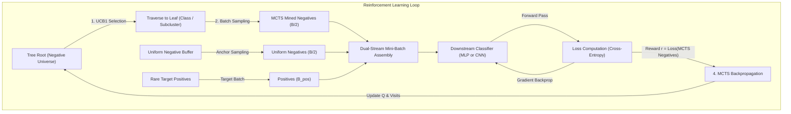

# ARCHITECTURE.md: MCTS-HNM System Architecture

This document specifies the technical design, reinforcement learning formulation, tree construction mechanisms, and training pipelines for **MCTS-HNM** (*Monte Carlo Tree Search for Hard Negative Mining in Imbalanced Hierarchical Classification*).

---

## 1. System Overview

The system formulates active negative sample selection as a **Sequential Decision Process on a Hierarchical Tree of Negative Classes**. 

Instead of sampling negative instances uniformly at random or performing greedy batch-level hard mining (which lacks global memory), an MCTS agent navigates a tree representation of negative classes to sample mini-batches that maximize downstream classification loss (i.e., boundaries of highest ambiguity).



---

## 2. Reinforcement Learning Formulation

### 2.1 State Space ($\mathcal{S}$)
A state $s \in \mathcal{S}$ represents a node in the hierarchical tree $\mathcal{T} = (\mathcal{V}, \mathcal{E})$.
- **Virtual Root ($s_0$):** Encompasses all $K-1$ negative classes.
- **Internal Nodes ($s_{\text{int}}$):** Superclasses, taxonomical families, or intermediate confusion clusters.
- **Leaf Nodes ($s_{\text{leaf}}$):** Concrete individual classes or fine-grained clusters of instances.

### 2.2 Action Space ($\mathcal{A}(s)$)
At node $s$, an action $a \in \mathcal{A}(s)$ consists of selecting which child node $s' \in \text{Children}(s)$ to traverse.

### 2.3 Tree Traversal & UCB1 Selection Policy
At each internal node $s$, the selection policy selects the child node $i$ that maximizes a normalized Upper Confidence Bound (UCB1):

$$a^* = \arg\max_{i \in \text{Children}(s)} \left( \bar{Q}_i^{\text{norm}} + c \cdot \sqrt{\frac{\ln N_s}{n_i + \epsilon}} \right)$$

Where:
- $N_s$: Total visit count of parent node $s$ ($N_s = \sum_j n_j$).
- $n_i$: Visit count of child node $i$.
- $c$: Exploration coefficient balancing exploitation (high classification loss) and exploration (infrequently visited clades).
- $\bar{Q}_i^{\text{norm}}$: Min-Max normalized value estimate within $[0, 1]$:
  $$\bar{Q}_i^{\text{norm}} = \frac{\bar{Q}_i - Q_{\min}}{Q_{\max} - Q_{\min} + \epsilon}$$
  *Note:* Normalization prevents unbounded cross-entropy loss values from overpowering the exploration term.

### 2.4 Simulation (Rollout & Loss Computation)
Once a leaf node $s_{\text{leaf}}$ is selected:
1. Sorteia-se um sub-lote de tamanho $K_{\text{neg}}$ contendo instâncias negativas pertencentes exclusivamente a $s_{\text{leaf}}$.
2. O lote é combinado com as instâncias positivas da classe alvo e instâncias negativas uniformes de regularização.
3. Passa-se o lote pelo modelo supervisionado atual $f_\theta$.
4. **Função de Recompensa ($r$):**
   $$r = \frac{1}{K_{\text{neg}}} \sum_{j=1}^{K_{\text{neg}}} -\log(1 - p_\theta(y=1 \mid x_j^{-}))$$
   *Intuição:* Quanto maior a probabilidade atribuída à classe positiva em exemplos negativos, maior é o erro do modelo, indicando um negativo difícil que recebe alta recompensa.

### 2.5 Backpropagation & Momentum
The reward $r$ updates the tree backwards from leaf to root:
1. **Leaf Node Update (Exponential Moving Average / Momentum):**
   $$Q_{\text{leaf}}^{(t)} = \alpha \cdot r + (1 - \alpha) \cdot Q_{\text{leaf}}^{(t-1)}$$
   Default momentum coefficient: $\alpha = 0.3$. This smooths variance from mini-batch sampling while remaining responsive to model weight evolution.
2. **Internal Node Update (Weighted Hierarchical Aggregation):**
   $$Q_p = \frac{1}{M_p} \sum_{c \in \text{Children}(p)} M_c \cdot Q_c$$
   Where $M_c$ and $M_p$ denote the number of instances encompassed by child node $c$ and parent node $p$, respectively.

---

## 3. Dual Tree Construction Engine

The framework implements and compares two distinct tree structures:

```text
┌────────────────────────────────────────────────────────────────────────┐
│                        Mode A: Semantic Tree                           │
│  Root -> [20 Superclasses] -> [100 Fine Classes] (Static Taxonomy)     │
└────────────────────────────────────────────────────────────────────────┘

┌────────────────────────────────────────────────────────────────────────┐
│                    Mode B: Confusion-Driven Tree                       │
│  Model Errors -> Confusion Matrix C -> Distance D -> Ward Clustering   │
│  Root -> Binary Dendrogram -> [Fine Classes grouped by visual error]  │
└────────────────────────────────────────────────────────────────────────┘
```

### Mode A: Semantic Hierarchy
- **Source:** Ground-truth taxonomy from CIFAR-100 (20 coarse labels $\times$ 5 fine labels).
- **Depth:** Fixed depth of 2 (Root $\rightarrow$ Superclass $\rightarrow$ Class).
- **Properties:** Captures human cognitive groupings (e.g., *aquatic mammals*, *vehicles 1*).

### Mode B: Confusion-Driven Hierarchy (Ward Clustering)
- **Source:** Empirical errors of a baseline classifier.
- **Procedure:**
  1. Compute confusion matrix $C \in \mathbb{R}^{K \times K}$ over validation split.
  2. Compute symmetric normalized confusion distance:
     $$D_{i,j} = 1 - \frac{C_{i,j} + C_{j,i}}{2 \cdot \max(C)}$$
  3. Execute Agglomerative Hierarchical Clustering using **Ward's minimum variance method**.
  4. Convert the resulting linkage matrix into a binary tree with leaves corresponding to classes.
- **Properties:** Clusters classes based on perceptual and latent-feature similarity (e.g., grouping *shark* and *dolphin* together based on aquatic visual backgrounds rather than mammalian taxonomy).

---

## 4. Dual-Stream Mini-Batch Training

To prevent **catastrophic forgetting** of easy classes and eliminate gradient instability:

$$\mathcal{B} = \mathcal{B}_{\text{pos}} \cup \mathcal{B}_{\text{uniform}} \cup \mathcal{B}_{\text{mcts}}$$

- $\mathcal{B}_{\text{pos}}$: Target rare class instances ($B_{\text{pos}} = 16$).
- $\mathcal{B}_{\text{uniform}}$: Randomly sampled negative instances from the entire negative space ($B_{\text{uni}} = 24$).
- $\mathcal{B}_{\text{mcts}}$: Hard negative instances mined from the leaf selected by the MCTS agent ($B_{\text{mcts}} = 24$).

---

## 5. Two-Tier Execution Strategy

```text
Tier 1: Fast Feature Prototyping
├── Frozen Backbone (ResNet-18 / ViT pretrained on ImageNet)
├── Precomputed Feature Cache (512-d or 768-d vectors in RAM/GPU)
├── Trainable Head: 2-layer MLP (512 -> 128 -> 1 + Sigmoid)
└── Throughput: > 1,000 MCTS steps/sec; 5 seeds completed in ~15 mins.

Tier 2: End-to-End Vision Pipeline
├── Trainable CNN Backbone (ResNet-18 / ConvNeXt-Tiny)
├── Raw RGB image augmentation (RandomCrop, RandomHorizontalFlip)
└── Benchmark confirmation of feature adaptation dynamics.
```

---

## 6. Evaluation Metrics & Scientific Rigor

1. **Classification Performance (Imbalance Regime):**
   - **F1-Score:** Harmonic mean of precision and recall.
   - **AUPRC:** Area Under the Precision-Recall Curve (the gold standard for class-imbalanced evaluation).
   - **False Positive Rate at 95% Recall (FPR@95):** Measures decision boundary tightness.
2. **RL Agent Diagnostics:**
   - **Tree Visitation Entropy ($H_t$):**
     $$H_t = -\sum_{i \in \text{Leaves}} p_i \ln p_i, \quad p_i = \frac{n_i}{\sum_j n_j}$$
     Monitors whether the agent focuses on critical clades or degenerates into tunnel vision.
   - **Sample Convergence Rate:** Number of gradient updates required to reach target F1 thresholds.
3. **Statistical Testing:**
   - All experimental conditions executed across 5 independent random seeds.
   - Statistical significance verified via paired Student's $t$-test and Wilcoxon signed-rank tests ($p < 0.05$).
