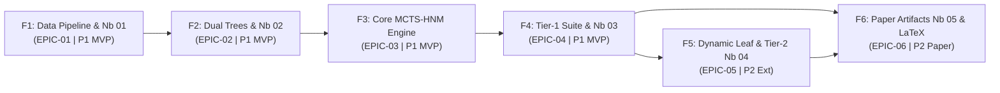

# MCTS-HNM Project Roadmap (Master Epic)

**Epic Specification**: [`.specs/features/00-epic-roadmap/spec.md`](.specs/features/00-epic-roadmap/spec.md)  
**Architectural Decisions**: [`.specs/STATE.md`](.specs/STATE.md) (`AD-001` – `AD-008`)  
**Methodology**: TLC Spec-Driven Development (`Specify` $\rightarrow$ `Design` $\rightarrow$ `Tasks` $\rightarrow$ `Execute`)  
**Execution Pattern (`AD-008`)**: Modular `.py` library in `src/` + versioned `.ipynb` orchestration notebooks in `notebooks/` for remote JupyterHub execution.

---

## 1. Epic Overview & Hierarchy

This roadmap decomposes the **MCTS-HNM** research project into **6 sequential Features (`F1`–`F6`)**, **18 Issues (`ISS-01`–`ISS-18`)**, and **25 atomic Tasks (`T1.1`–`T6.5`)**, tracing directly to the epic requirements (`EPIC-01`–`EPIC-06`).

### Versioned Notebooks Inventory (`notebooks/`)

| Notebook | Stage Covered | Calls into `src/` |
| -------- | ------------- | ----------------- |
| `notebooks/00_master_end_to_end.ipynb` | Full pipeline orchestrator (Download $\rightarrow$ Embeddings $\rightarrow$ Trees $\rightarrow$ Benchmarks $\rightarrow$ Paper Artifacts) | All `src.*` high-level APIs |
| `notebooks/01_data_and_embeddings.ipynb` | CIFAR-100 download, frozen ResNet-18 extraction, imbalanced Scenario 1 & 2 split verification | `src.data.*`, `src.utils.seed` |
| `notebooks/02_tree_construction.ipynb` | Native Semantic Tree vs. Ward Confusion Tree construction & dendrogram visualization | `src.trees.*` |
| `notebooks/03_tier1_mcts_benchmarks.ipynb` | Multi-seed Tier-1 experiments (MCTS vs. Uniform vs. OHEM; Semantic vs. Confusion; $c$ & $\alpha$ ablations) | `src.mcts.*`, `src.models.*`, `src.training.*` |
| `notebooks/04_tier2_e2e_and_expansion.ipynb` | Dynamic entropy leaf sub-clustering (P2) & Tier-2 end-to-end ResNet-18 fine-tuning | `src.mcts.expansion`, `src.training.e2e_trainer` |
| `notebooks/05_paper_artifacts.ipynb` | Statistical tests ($t$-test, Wilcoxon), vector PDF plots, and LaTeX booktabs table generation | `src.utils.statistics`, `src.utils.paper_artifacts` |

---

## 2. Feature, Issue, and Task Breakdown

### Feature F1: Project Scaffold, CIFAR-100 Loader & Embedding Cache (`EPIC-01` | P1 MVP)
- **Spec Path**: `.specs/features/01-data-and-embeddings/`
- **Goal**: Establish `pyproject.toml` (with Jupyter/`ipykernel` support), deterministic seeding, CIFAR-100 fine/coarse label mapping, frozen ResNet-18 embedding extraction in `src/data/`, and versioned notebook `notebooks/01_data_and_embeddings.ipynb`.
- **Issues & Planned Tasks**:
  - **`ISS-01`: Package, Jupyter Kernel & Environment Setup (`AD-003`, `AD-008`)**
    - `T1.1`: Create `pyproject.toml` with PyTorch, Torchvision, NumPy, SciPy, Scikit-Learn, Matplotlib, Seaborn, `ipykernel`, `nbformat`, and `pytest`.
    - `T1.2`: Implement deterministic seed manager (`src/utils/seed.py`) covering `random`, `numpy`, and `torch`.
  - **`ISS-02`: CIFAR-100 Taxonomy & Embedding Extractor (`AD-001`)**
    - `T1.3`: Implement CIFAR-100 loader with explicit 20-superclass $\leftrightarrow$ 100-fine-class mapping table (`src/data/cifar100_taxonomy.py`).
    - `T1.4`: Build programmatic frozen ResNet-18 feature extractor (`src/data/extract_embeddings.py`) exporting train/val/test tensors (`[N, 512]`) to disk with checksum/cache reuse.
  - **`ISS-03`: Imbalanced Scenario Splitters & Notebook 01 (`AD-004`, `AD-008`)**
    - `T1.5`: Implement Scenario 1 (One-vs-Rest imbalanced binary splitter, $\rho \in \{1:10, 1:50, 1:100\}$) and Scenario 2 (100-way multi-class curriculum index pool) in `src/data/splits.py`.
    - `T1.6`: Create versioned `notebooks/01_data_and_embeddings.ipynb` executing CIFAR-100 download, embedding extraction, and class distribution visualizations.

---

### Feature F2: Dual Hierarchy Construction Engine (`EPIC-02` | P1 MVP)
- **Spec Path**: `.specs/features/02-dual-hierarchy-trees/`
- **Goal**: Build vectorized, zero-overhead tree structures in `src/trees/` supporting both static CIFAR-100 Semantic Hierarchy and empirical Ward Confusion Hierarchy, driven by `notebooks/02_tree_construction.ipynb`.
- **Issues & Planned Tasks**:
  - **`ISS-04`: Vectorized Tree Data Structure**
    - `T2.1`: Implement `FastHierarchyTree` (`src/trees/base_tree.py`) storing `parents`, `children`, `is_leaf`, `instance_counts`, `visits`, and `q_values` in contiguous NumPy arrays.
  - **`ISS-05`: Mode A — Native Semantic Hierarchy Builder (`AD-002`)**
    - `T2.2`: Implement `build_semantic_tree()` (`src/trees/semantic_tree.py`) mapping Virtual Root $\rightarrow$ 20 Superclasses $\rightarrow$ Fine Classes (99 negative leaves in Scenario 1; 100 leaves in Scenario 2).
  - **`ISS-06`: Mode B — Data-Driven Ward Confusion Tree & Notebook 02 (`AD-002`, `AD-008`)**
    - `T2.3`: Implement confusion distance computation $D_{i,j} = 1 - \frac{C_{i,j} + C_{j,i}}{2 \cdot \max(C)}$ and Ward linkage conversion (`src/trees/confusion_tree.py`).
    - `T2.4`: Create versioned `notebooks/02_tree_construction.ipynb` building both trees, plotting the confusion matrix and Ward dendrogram, and exporting serialized tree artifacts.

---

### Feature F3: Core MCTS Hard Negative Mining Agent (`EPIC-03` | P1 MVP)
- **Spec Path**: `.specs/features/03-mcts-hnm-agent/`
- **Goal**: Implement the 4-phase MCTS training agent (`src/mcts/`) supporting both Strict GiantHunter equations and Enhanced MCTS-HNM (Min-Max $Q$-normalization and Dual-Stream batching).
- **Issues & Planned Tasks**:
  - **`ISS-07`: UCB1 Selection & Min-Max Q-Normalization (`AD-005`)**
    - `T3.1`: Implement tree traversal from root to leaf using UCB1 (`src/mcts/agent.py`), prioritizing unvisited children ($n_i = 0$) and supporting `q_norm: bool` toggle.
  - **`ISS-08`: Momentum Backpropagation & Hierarchical Aggregation**
    - `T3.2`: Implement leaf momentum update $Q_l^{(t)} = \alpha r + (1 - \alpha) Q_l^{(t-1)}$ ($\alpha = 0.3$) and instance-weighted ancestor aggregation $Q_p = \frac{1}{M_p} \sum M_c Q_c$.
  - **`ISS-09`: Dual-Stream Batch Sampler & RL Diagnostics (`AD-005`)**
    - `T3.3`: Implement `DualStreamBatchSampler` (`src/mcts/sampler.py`) combining MCTS-selected leaf instances with uniform anchor instances according to `dual_stream_ratio`.
    - `T3.4`: Implement Tree Visitation Entropy $H_t = -\sum p_i \ln p_i$ and per-superclass visit distribution trackers (`src/mcts/diagnostics.py`).

---

### Feature F4: Downstream Classifiers, Baselines & Tier-1 Benchmark Notebook (`EPIC-04` | P1 MVP)
- **Spec Path**: `.specs/features/04-tier1-benchmark-suite/`
- **Goal**: Train and compare Uniform Sampling, OHEM, Strict GiantHunter, and Enhanced MCTS-HNM across Scenario 1 and Scenario 2 on Tier-1 embeddings with 5 random seeds, orchestrated via `notebooks/03_tier1_mcts_benchmarks.ipynb`.
- **Issues & Planned Tasks**:
  - **`ISS-10`: Downstream Models & Baseline Samplers**
    - `T4.1`: Implement Tier-1 MLP classification head (`src/models/mlp_head.py`) matching GiantHunter's `Adam(lr=1e-3)` setup.
    - `T4.2`: Implement `UniformSampler` and `OHEMSampler` (`src/training/baselines.py`) as non-tree baselines.
  - **`ISS-11`: Scenario 1 & Scenario 2 Unified Trainer (`AD-004`)**
    - `T4.3`: Implement Scenario 1 trainer (`BCEWithLogitsLoss`, evaluating F1, Precision, Recall, AUPRC, FPR@95) in `src/training/trainer.py`.
    - `T4.4`: Implement Scenario 2 trainer (`CrossEntropyLoss(label_smoothing=0.1)`, evaluating Top-1 Accuracy, Macro-F1, Worst-10-Class Recall) in `src/training/trainer.py`.
  - **`ISS-12`: Multi-Seed Runner, Statistical Tests & Notebook 03 (`AD-008`)**
    - `T4.5`: Implement programmatic benchmark runner (`src/training/benchmark_runner.py`) and statistical test suite (`src/utils/statistics.py`: paired $t$-test and Wilcoxon signed-rank).
    - `T4.6`: Create versioned `notebooks/03_tier1_mcts_benchmarks.ipynb` executing the 3 core experimental axes across $N = 5$ seeds and saving structured JSON/CSV results to `results/`.

---

### Feature F5: Dynamic Entropy Leaf Expansion & Tier-2 End-to-End CNN Notebook (`EPIC-05` | P2 Extension)
- **Spec Path**: `.specs/features/05-extensions-and-e2e/`
- **Goal**: Extend the MCTS tree with dynamic entropy-based sub-clustering at the leaf level (`AD-006`) and validate the winning configuration end-to-end on a trainable ResNet-18 backbone (`AD-001`), driven by `notebooks/04_tier2_e2e_and_expansion.ipynb`.
- **Issues & Planned Tasks**:
  - **`ISS-13`: Dynamic Leaf Sub-Clustering by Prediction Entropy (`AD-006`)**
    - `T5.1`: Implement dynamic leaf splitting (`src/mcts/expansion.py`) triggered when $n_l \ge N_{\text{split}}$, partitioning class instances into $K_{\text{sub}}$ entropy quantiles.
  - **`ISS-14`: Tier-2 End-to-End Vision Pipeline & Notebook 04 (`AD-001`, `AD-008`)**
    - `T5.2`: Implement trainable ResNet-18 end-to-end trainer (`src/training/e2e_trainer.py`) on raw CIFAR-100 images with periodic confusion tree refreshes.
    - `T5.3`: Create versioned `notebooks/04_tier2_e2e_and_expansion.ipynb` running the P2 dynamic expansion ablation and Tier-2 end-to-end validation on JupyterHub.

---

### Feature F6: Automated Paper Artifacts, Master Notebook & LaTeX Manuscript (`EPIC-06` | P2 Deliverable)
- **Spec Path**: `.specs/features/06-paper-and-artifacts/`
- **Goal**: Render publication plots and booktabs tables via `notebooks/05_paper_artifacts.ipynb`, provide the single-click `notebooks/00_master_end_to_end.ipynb` orchestrator, and compile the complete scientific paper in the Overleaf arXiv/Prime AI template (`AD-007`, `AD-008`).
- **Issues & Planned Tasks**:
  - **`ISS-15`: Automated Figure & Table Generator + Notebooks 05 & 00 (`AD-008`)**
    - `T6.1`: Implement `src/utils/paper_artifacts.py` exporting convergence curves, tree visitation heatmaps, and LaTeX booktabs tables (`paper/figures/`, `paper/tables/`).
    - `T6.2`: Create versioned `notebooks/05_paper_artifacts.ipynb` and `notebooks/00_master_end_to_end.ipynb` (single-entry end-to-end pipeline from CIFAR-100 download to paper figures).
  - **`ISS-16`: LaTeX Template Setup (`arXiv / Prime AI`)**
    - `T6.3`: Set up `paper/main.tex`, `PRIMEarxiv.sty`, and `references.bib` (citing GiantHunter, Sutton & Barto, Auer 2000, Shrivastava 2016).
  - **`ISS-17`: Scientific Manuscript Drafting**
    - `T6.4`: Write `Abstract`, `Introduction`, `Related Work`, `Methodology`, `Experimental Setup`, `Results`, `Discussion & Limitations`, and `Conclusion`.
  - **`ISS-18`: Manuscript Compilation & Verification**
    - `T6.5`: Compile `paper/main.pdf` and verify zero LaTeX warnings, broken references, or missing figures.

---

## 3. Execution Protocol (TLC Spec-Driven)

Each Feature (`F1` through `F6`) will be executed sequentially through the `tlc-spec-driven` workflow:
1. **Specify**: Create `.specs/features/0X-.../spec.md` and pass `validate_spec.py`.
2. **Design**: Create `.specs/features/0X-.../design.md` mapping exact module interfaces in `src/` and notebook cells in `notebooks/`.
3. **Tasks**: Create `.specs/features/0X-.../tasks.md` with per-task test gates and pass `validate_tasks.py`.
4. **Execute & Verify**: Implement each task with an atomic commit, run `check_proofs.py`, and run the independent Verifier before moving to the next feature.
